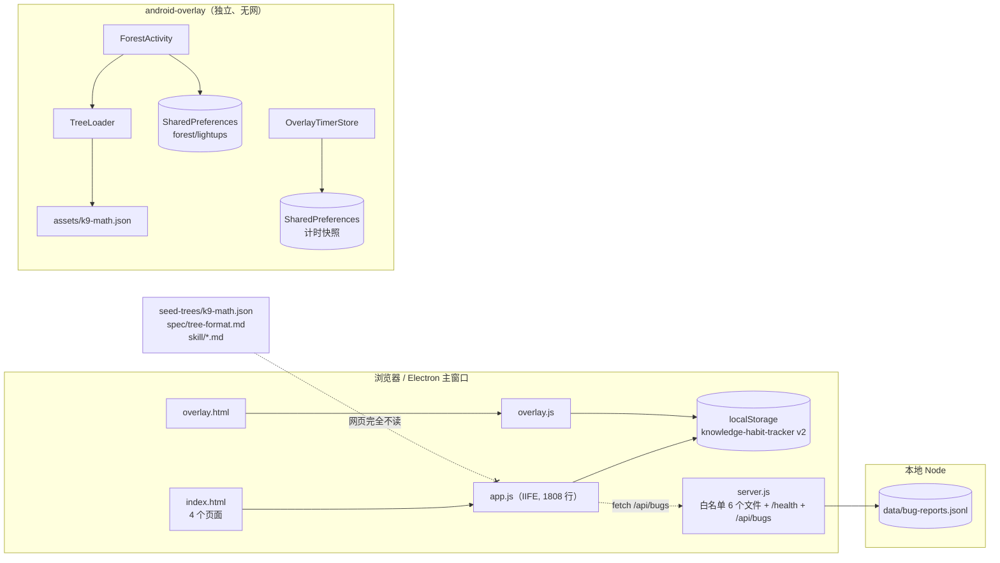

# 点亮森林 · 第一刀实施设计（从当前代码到第一个可交付增量）

| 项 | 值 |
| --- | --- |
| 文档标题 | 点亮森林 · 第一刀实施设计（当前代码 → 第一个可交付增量） |
| 作者 | 待定 |
| 日期 | 2026-09-25 |
| 状态 | Draft |
| 修订 | v0.5（四评修订：仅 §4.9 两处文字与 `pruneStaleAim()` 的 v0.4 语义对齐——⑦ 的预置说明改为"用例的覆盖选择"并写明"旧时间戳 + 未知节点同样会 warn"，⑦ 的 warn 归属改为启动期 `pruneStaleAim()`，末尾段落删除"旧时间戳拿不到 warn"的旧叙述；**算法未改**。v0.4：悬空判定独立于 TTL、`lastAimNotice` → `#node-card-notice`、迁移测试单一触发器、交付摘要重生。v0.3：种子包 require 缓存、悬空警告归属、`activeTreeId` 纯懒回退、行数与 `render()` 区间、`findLightUpByEventId` 归属、Key Decision 17 措辞、三处 `lightUp` 具体改法、徽标查询 Map 索引。v0.2：瞄准生命周期、迁移测试口径、测试 harness、lightUp 与 lightups 唯一裁决、行号复核） |
| 前置文档 | `docs/knowledge-tree-phase2-design.md`（人类知识树二期，Q1–Q22 已定，MVP = M1–M4）；`spec/tree-format.md`（`forest-tree/v1`）；`skill/SKILL.md`、`skill/tools.md` |
| 代码基线 | `e86c96a`（"Improve tracker UX and add overlay app foundations"，`app.js` 共 **1808 行**，`})();` 为最后一行、文件以换行结尾）+ **未提交的工作区变更**：`index.html`（四页重排：新增 `data-page="overview"` 页与导航按钮，hub 开关与概览网格移入该页，随手记按钮改名）、`android-overlay` 主界面三件套（`AndroidManifest.xml`、`MainActivity.kt`、`activity_main.xml`）、以及新增的 `docs/`、`seed-trees/`、`spec/`、`skill/`、`android-overlay` 的 forest 部分 |
| 基线前提 | 本设计建立在"四页导航 + 概览独立页"这次工作区改动之上（§4.7 的概览卡、hub 开关行号 `index.html:118-125`、四页前提都由它成立）。**开始 PR-1 之前，先把这次工作区改动落成一个基线提交**（它不属于本设计的 PR 序列），否则后续 PR 的 diff 会混入这部分、且评审无法判断页面结构是否一致 |
| 适用范围 | 一期产品「点亮习惯记录器」的网页端（`index.html` + `app.js` + `style.css`），以及为它服务的 `server.js` 白名单与测试 |
| 明确不在范围 | 治理/投票、支付、联邦、账号、Android 完整客户端、MCP server、E2E 同步（→ 二期文档 M2 及以后） |

本文不重写二期愿景长文，只回答一个工程问题：**从今天仓库里真正能跑的代码出发，第一个可交付增量是什么、怎么做、怎么迁状态、怎么测、怎么回滚。**

> 行号核对说明：本文所有 `文件:行` 引用均在 2026-09-25 对照工作区的实际文件重新核对过；`app.js` 的行号基于当前 **1808 行**的版本（`})();` 在第 1808 行、文件以换行结尾——用 `content.split(/\r?\n/)` 会多出一个空元素，得到 1809 项，本文一律按"行号 1..1808"计；未提交改动中不含 `app.js`，因此与 `e86c96a` 一致）。

## 0. 本文对七个问题的结论索引

| # | 问题 | 结论 | 详见 |
| --- | --- | --- | --- |
| 1 | 现在代码实际做到哪，离 M1–M4 差在哪 | 网页端：一期功能完整可用，与二期 **零交集**；Android：M1 的「读树 + 自证点亮」已有半成品但未编译验证、未接事件 | §2 |
| 2 | 第一刀切在哪 | 网页里打通「本地种子树 → 节点挂靠 → 本地点亮草稿」；否决「把节点候选升级为森林节点」与「先做 Android/MCP」 | §4.1、§4.2 |
| 3 | 状态怎么迁 | `version: 3`，新增 `state.forest`；`normalizeState` 对旧备份做默认填充（**迁移即归一化**，不写一次性迁移器）；**启动不写盘**（版本迁移只在内存里发生，下一次真实 `saveState()` 才落 v3）；`importBackup` 加「拒绝更新版本」守卫 | §4.8、§6 |
| 4 | 树数据放哪 | 由 `seed-trees/*.json` 生成 `seed-trees/seed-trees.js`（`root.FOREST_SEED_TREES`），`<script>` 同步加载；`server.js` 白名单新增该文件；**不用 `fetch`**（`file://` 打不开） | §4.5 |
| 5 | UI 加什么不加什么 | 计时页加「瞄准节点」选择器 + 节点卡；手动记录表单加 `#done-node-select`；记录查看页加第 5 个页签「点亮」；不加新导航页、不加树图、不引入 React/构建链 | §4.7 |
| 6 | 测试怎么补 | 把 `loadApp` 提成 `tests/frontend/harness.js`（带 `{ seedState, withSeedBundle }` 参数），其余沿用 vitest + jsdom + `require("app.js")` | §4.9 |
| 7 | 仓库里的重复文件这一轮删不删 | 删（独立 PR-0，不阻塞功能）；`点亮森林-M1.apk` 不入库、加 `.gitignore` | §4.10 |

---

## 1. 概述

一期「点亮习惯记录器」已经是一个能自用的东西：单习惯养成、番茄计时、手动/随手记事件沉淀、四个页面的记录查看、JSON 备份导入导出、本机反馈日志，全部跑在 `localStorage` 单键 `knowledge-habit-tracker` 上（`version: 2`）。它已经有了"事件"，但**没有任何"目标"**：`buildNodeCandidates()` 聚合出来的「节点候选」只是重复标题的计数视图，既不能编辑，也不会写成 `forest-tree/v1` 节点。而 `settings.hubConnected` 这个开关自称「同步到知识共建平台」，实际只做一件事——把新事件的 `lightUp` 布尔字段设为 `true`（`app.js:436`、`app.js:463`、`app.js:538`）。仓库里已经有 `spec/tree-format.md`、`seed-trees/k9-math.json`（26 节点/27 边/3 教程）、`skill/`，但**网页一个字节都不读**。

本文提出的第一个可交付增量（下称「第一刀」）是：**把本地种子树读进现有网页，让一次计时或一次手动记录能瞄准一个节点，结束时留下一条本地点亮草稿，用户显式确认后成为本地点亮（L1 自证）。** 全程零网络、零 LLM、零服务端改动（除了静态白名单多一个文件），不新增框架、不新增构建步骤，状态从 `version: 2` 平滑升到 `version: 3`，v2 备份照常导入。

这一刀之后，二期文档 §4.6 的双向闭环里第一次出现了**「节点 → 行动挂靠」**这一段（注意措辞：不是闭环的"前半段"。前半段是"由节点教程派生出下一件要做的事"即待办桥，本刀不做，见 §3.2），以及**后半段的一半**：一次真实行动留下了一条可追溯的本地点亮证据（`lightup.eventId` 指向该事件），且形状与 Android 侧已存在的 `ForestStore` 记录一致。

---

## 2. 背景与动机

### 2.1 现在真正能跑的（逐项引用）

| 能力 | 实现位置（2026-09-25 核对） |
| --- | --- |
| 单习惯养成（一次只养一个，21–365 天） | `createHabit()` `app.js:363`、`completeActiveHabit()` `app.js:403`、`normalizeHabit()` `app.js:1600` |
| 番茄计时（开始/暂停/重置/结束） | `startTimer()` `app.js:493`、`pauseTimer()` `app.js:508`、`resetTimer()` `app.js:519`、`finishTimer()` `app.js:528`（`elapsedMs <= 0` 早退在 `app.js:531`） |
| 计时落盘节流（250ms 渲染、5s 写盘） | `startTimerTicker()` `app.js:564`（`lastTimerPersist`，阈值 5000ms） |
| 事件三来源：手动 / 计时结束 / 随手记 | `createManualEvent()` `app.js:428`、`finishTimer()` `app.js:528`、`createQuickNoteEvent()` `app.js:456`；字段见 `normalizeEvent()` `app.js:1619` |
| 事件视图（全部/今天/7天/30天 + 搜索） | `renderDoneList()` `app.js:659`、`filterEvents()` `app.js:1503`、`matchesRange()` `app.js:1517` |
| 节点候选（只读聚合：`habitId+title` ≥ 2 次，取前 8） | `buildNodeCandidates()` `app.js:1364`、`renderNodeCandidates()` `app.js:716` |
| 习惯聚合 / 日周月视角 | `buildHabitGroups()` `app.js:1403`、`buildPeriodGroups()` `app.js:1425`、`renderPeriodViews()` `app.js:769` |
| JSON 备份导出/导入 | `exportBackup()` `app.js:1149`、`importBackup()` `app.js:1170`、`normalizeState()` `app.js:1568` |
| 状态存取（单键、全量 JSON） | `STORAGE_KEY` `app.js:2`、`loadState()` `app.js:1556`、`saveState()` `app.js:1645`、`defaultState` `app.js:7` |
| 启动序列（**不含任何写盘**） | `app.js:114-117`：`bindEvents(); elements.hubToggle.checked = …; render(); startTimerTicker();` |
| 静态服务 + 反馈接口（业务数据不进服务端） | `PUBLIC_FILES` `server.js:6-12`、`/health` `server.js:65`、`GET /api/bugs` `server.js:76`、`POST /api/bugs` `server.js:91`、CSP `server.js:26`、限流 `createRateLimiter()` `server.js:192`、来源白名单 `server.js:40-52` |
| 桌面悬浮窗（与主窗口共享 localStorage，与浏览器不共享） | `electron/main.js`（起 `server.js` 子进程 + 加载 `http://127.0.0.1:3000`）、`overlay.js`（读同一 key 的 `state.timer` 与 `state.events[].title`，见 §4.8 兼容矩阵） |
| 四个页面 + 记录页签 | `index.html:15-20`（导航）、`data-page` 四页在 `index.html:23 / 107 / 149 / 392`、记录页签按钮在 `index.html:260-263`（按钮用 `data-record-tab-target`，区块用 `data-record-tab`，见 `renderRecordTabs()` `app.js:650`） |

### 2.2 与二期 M1–M4 的差距（对照表）

| 二期里程碑 | 二期要求（§8 MVP 表） | 当前实际 | 证据（文件/函数） | 差距 |
| --- | --- | --- | --- | --- |
| **M1 本地知识树** | AI skill + 本地 JSON 树 + Android APK；节点/教程/边 CRUD；默认折叠；5–15 分钟粒度；个人持有 | 网页：**完全不读树**（`app.js` 内无 tree/seed/forest 引用）。Android：`ForestActivity` 能读 `assets/k9-math.json` → 列节点、点开看目标/自证提示/推荐前置/折叠教程标题、AlertDialog 里自证点亮。无 CRUD（只读）。种子树 26 节点全为 `ownership: "group"`。`skill/` 只是 Markdown 文档 | `app.js`（无引用）；`android-overlay/.../tree/Tree.kt`（`TreeLoader.parse`）、`forest/ForestStore.kt`（SharedPreferences `forest/lightups`）、`ForestActivity.kt:20-71`；`seed-trees/k9-math.json`（10,922 字节，26/27/3）；`skill/SKILL.md`、`skill/tools.md` | 网页侧 100%；Android 缺「事件关联」「草稿/确认两态」「CRUD」；`android-overlay/README-BUILD.md` 自述「未经编译」；根目录 `点亮森林-M1.apk`（12,942,025 字节，未跟踪）**无法确认与当前源码对应**，不能当作已交付 |
| **M2 点亮与爬行** | 机证判题点亮、路径发布、爬行进度（单机服务，可局域网） | 「点亮」只是事件上一个布尔：`lightUp = state.settings.hubConnected`，无节点、无 `tutorialId`、无 `evidence`、无 `verified`；无 trail/path 概念；`spec/tree-format.md` §3.5 的 `LightUp` 形状在网页端零实现 | `app.js:436/443`、`app.js:463/470`、`app.js:538/546`；`normalizeEvent()` 里的 `lightUp: Boolean(rawEvent.lightUp)` 在 `app.js:1632`；`settings.hubConnected` 归一化在 `app.js:1594`；`spec/tree-format.md` §3.5 | 全缺（Android 侧有 `LightUp{nodeId,tutorialId,detail,timestamp}`，与 spec 部分对齐但缺 `status/eventId/treeId`） |
| **M3 提案投票** | 转群体持有 / 分裂 / 合并提案 + 投票（小圈子 3–5 人） | 无账号、无投票、无提案；只有 `spec/tree-format.md` §3.4 定义了 `Issue` 形状 | `server.js`（只有 `/health`、`/api/bugs`）；`docs/knowledge-tree-phase2-design.md` §4.3/§4.4 | 全缺；**本设计明确排后**（非目标） |
| **M4 闭环** | 选中节点 → 事件记录器待办（5–15 分钟槽）→ 打卡 → 证据回传 → 卡点聚合 | 只有「事后聚合」：`buildNodeCandidates()` 把 ≥2 次的标题聚成候选卡片，既不能选中、也不能挂到事件、更不能回传。事件没有 `nodeId`，也没有任何 `source: "node-task"` 的待办态 | `buildNodeCandidates()` `app.js:1364`、`renderNodeCandidates()` `app.js:716`、`normalizeEvent()` `app.js:1619`（无 `nodeId`） | 闭环首尾都缺；本刀补「节点 → 行动挂靠 → 本地点亮草稿」，**不补**「待办队列（节点→下一件要做的事）」与「回传」（仍非目标） |

补充：`eslint.config.js:6-12` 的 `ignores` 已经把 `app-offline.js`、`server-secure.js`、`server-basic-secure.js`、`storage-manager.js` 排除了——这本身就是「仓库里存在不属于运行路径的文件」的证据（见 §4.10）。

### 2.3 现在就存在的两处概念误导（必须随本刀一并收敛）

1. **`settings.hubConnected` 自称同步/上传，其实不上传。** UI 文案是「同步到知识共建平台」/「打开后，记录会被标记为"点亮事件"」（`index.html:118-125`，标题在 119、帮助文案在 120），行为只是给事件打 `lightUp: true`。一期 README 的「数据边界」也说明了没有上传，但界面在撒谎。
2. **「节点候选」会被读成森林节点。** 它是 `habitId+title` 的重复计数（`app.js:1364`），语义是"做过的动作"，而森林节点描述的是"要达成的目标"（二期 §4.8）。二者不同构：候选无 goal/estMinutes/verifyHint，且时长是"已发生"的，不是"建议"的。

---

## 3. 目标与非目标

### 3.1 目标（第一刀的验收边界）

- **G1** 网页在自己的运行环境（`npm start` 的 http、Electron 主窗口、`file://` 直开 `index.html`）都能拿到本地种子树 `k9-math`。
- **G2** 用户能在**两个使用现场**选中同一个「瞄准节点」：计时页用 `#node-picker`（搜索 + 列表），手动记录表单（`index.html:225` 的 `#done-form`）用 `#done-node-select`（原生 `<select>`，首项为「不挂节点」）。两处读写同一个 `state.forest.selectedNodeId`，因此切换页面时看到的是同一个选择。节点卡展示 `goal`、`verifyHint`、`estMinutes`、推荐前置（`prereq`），教程**默认折叠**（展开前方法文本不出现在 DOM）。
- **G3** 一次计时结束或一次手动记录，若已瞄准节点，则**留下一版本地点亮草稿**，并与该事件双向可追（`lightup.eventId`）。
- **G4** 草稿可显式「确认点亮」（L1 自证）或删除；确认幂等；已点亮的节点在节点列表里显示为已点亮；瞄准可被显式清除（`#node-clear` 与 `<select>` 的空选项）。
- **G5** 状态升到 `version: 3`：**v2 备份导入后 habit/habitHistory/events/timer/settings 一个字段不丢**；v3 备份可导出；**版本迁移不在启动时写盘**（见 §4.8）。
- **G6** 新行为全部能用现有 vitest + jsdom + `require(app.js)` 方式覆盖；`npm run check` 绿。
- **G7** 使用森林功能期间 `fetch` 调用次数为 0（网络零新增）。

### 3.2 非目标（本刀不做，且理由充分）

| 非目标 | 理由 |
| --- | --- |
| 发布到森林 / 上传 / 账号 | 二期 M2 及以后；本刀只留形状（lightup 已按 spec 命名），**不建服务端接口**——避免"顺手就把个人事件传上去" |
| 机证/判题（L2 机证） | 点亮是 L1 自证，AI/程序都不承担验证（二期 §4.1、§5.4）。K9 数学的题集是实例节点的内容，不是本刀的事 |
| 待办队列（节点 → 下一件要做的事） | 这是二期 §4.6 的"前半段"与 M4 的范围；本刀只让用户把**自己已经决定要做的事**挂到一个节点上，不由节点派生行动（§13 的措辞修正） |
| 节点 CRUD / 版本哈希 / 内容寻址 | 需要哈希与版本链，属于 M1 的后半与 M2；本刀只读种子树 |
| 治理/投票/提案/支付 | 二期 M3、§4.4、§4.5；无账号基础设施，做了也无意义 |
| 路径（trail）与爬行进度 | 二期 M2；本刀不引入 `trail` 概念，避免半成品概念污染状态 |
| Android 完整客户端改造 | `ForestActivity` 已能读树+点亮，但方向是"先让网页跑通闭环，再让 Android 对齐同一形状"（见 PR-8） |
| MCP server | 二期 §5.3 的第二个 server；本刀连本地事件域都还没有稳定 schema |
| 跨终端同步 / E2E 加密 | 二期 §4.7 的远期项；继续用 JSON 备份 |
| 树可视化（DAG 图、SVG 布局） | 26 个节点的可搜索列表够用；图布局是纯成本，等节点上百再谈 |
| 引入 React / 打包器 | 见 §4.7「为什么不上框架」 |

---

## 4. 提议设计

### 4.1 第一刀切在哪（结论）

**在网页里打通「本地种子树 → 节点挂靠 → 本地点亮草稿」。**

具体到代码，这一刀要落 5 件事：

1. 种子树的**分发管道**（JSON → 生成物 → `<script>` → `window.FOREST_SEED_TREES` → `app.js` 内存索引）。
2. **瞄准节点的选择与生命周期**（§4.6.1）：计时页选择器 + 手动记录 `<select>` + 节点卡；可清除、可过期、被记录消费。
3. 事件新增 `nodeId` + `treeId`；`finishTimer()` 与 `createManualEvent()` 在已瞄准节点时创建 `status: "draft"` 的 lightup。
4. 记录查看页新增第 5 个页签「点亮」：左侧树节点列表（○/●），右侧点亮记录（草稿在前，可确认/删除）。
5. 状态 `version: 3` + 迁移/兼容 + 测试。

### 4.2 为什么切这里（以及被否决的三个替代方向）

**为什么是这里：** 它是唯一一处**同时**满足以下条件的切口——(a) 复用已经跑通的计时/事件/备份三条地基；(b) 让仓库里已经存在的资产（`spec/`、`seed-trees/`、`skill/`、Android 侧 `ForestStore`）第一次变成产品行为，而不是文档；(c) 是闭环的全部前置条件（没有"节点挂在事件上"，后面所有 M2/M4 都无从谈起）；(d) 零服务端、零 LLM、零新依赖，回滚就是把代码 revert（数据不丢，见 §10）。

**工作量口径：** 本轮的 6 个 PR 合计约 **5–8 人日**（含测试与文档），不是"一两天"。风险集中在 PR-3（挂靠 + 草稿 + 折叠规则）与 PR-4（确认 + 级联删除），预算按各 1.5–2.5 人日与 1–2 人日给（§PR Plan 有逐项估算）。

**替代 A：先把 `buildNodeCandidates()` 的候选升级成真正的森林节点。** 否决。候选是「已发生的动作标题」（`habitId+title` 计数），节点是「要达成的目标」（含 `goal`/`verifyHint`/`estMinutes`，二期 §4.8 明确"节点描述达成什么效果"）。自动把候选写成 `forest-tree/v1` 节点会同时犯三个错：语义错位（动作冒充目标）、粒度失控（事件时长自由，节点要求 5–15 分钟）、质量失控（个人随手记的标题直接成为可发布内容）。本刀的正确做法是**让候选保持它现在的身份，并在 UI 上说明它不是森林节点**（PR-5）；将来若要搭桥，也只能是**用户手写 goal 的显式升格流程**（PR-7，非本轮）。

**替代 B：先做 Android 完整客户端补完（M1 的另一半）。** 否决。Android 侧已经有半成品，但 `README-BUILD.md` 自述「未经编译」，且 Android 的存储（SharedPreferences）与网页（localStorage）天然隔离，先做它只会得到第二份各自的孤立数据模型。先让**网页**把「事件 ↔ 节点 ↔ 点亮」的形状定下来，Android 再对齐（PR-8 只需把 lightup 形状补齐 + 计时结束写一条草稿）。

**替代 C：先做 MCP server / skill 工具集（`skill/tools.md` 的 `record_event`/`local_lightup`）。** 否决（顺延）。MCP 工具需要确定性的本地数据模型作为地基，而 `local_lightup` 的参数 `nodeId/tutorialId/detail` 正是本刀要落的东西。先有本地实现，再有协议外壳，顺序不能反。此外 MCP 会引入"进程 + 传输"的复杂度，对第一个可交付增量是纯负担。

### 4.3 现状数据流（as-is）



关键结构事实：网页与 Android **没有任何共享**；网页的树资产存在但没有任何调用方；服务端不接触业务数据。

### 4.4 目标数据流（to-be，仅第一刀）

```mermaid
flowchart LR
  J["seed-trees/k9-math.json<br/>（规范源，git 内）"] --> GEN["scripts/build-seed-bundle.js<br/>npm run seed:bundle"]
  GEN --> BUN["seed-trees/seed-trees.js<br/>root.FOREST_SEED_TREES = {...}"]
  BUN -->|"&lt;script&gt; 同步加载（http 与 file:// 都能用）"| IDX["index.html"]
  IDX --> APP["app.js"]
  APP --> SEEDIDX["loadSeedTrees() → 内存索引<br/>nodes/edges/tutorials（不进 localStorage）"]
  SEEDIDX --> PICK["瞄准节点：计时页 #node-picker<br/>或 #done-node-select → state.forest.selectedNodeId"]
  PICK --> TIMER["计时 / 手动记录"]
  TIMER --> EV["event{ nodeId, treeId }"]
  TIMER --> DRAFT["lightup{ status: 'draft', eventId }<br/>并清空瞄准（一次性消费）"]
  DRAFT --> CONF["用户确认 → status: 'confirmed'"]
  EV --> LS[("localStorage v3<br/>新增 forest 块")]
  DRAFT --> LS
  CONF --> LS
  LS --> EXP["exportBackup() → JSON（v3）"]
  LS --> IMP["importBackup()（v2 老备份仍可导入）"]
```



新链路全部在浏览器内闭合，`fetch` 计数为 0。

### 4.5 树数据怎么进页面（`server.js` 白名单是真约束）

**约束核查：** `server.js:6-12` 的 `PUBLIC_FILES` 是白名单 `Map`，只放行 `/`、`/index.html`、`/app.js`、`/style.css`、`/overlay.html`、`/overlay.js`；`tests/server.test.js:32-35` 已经用 `/README.md → 404` 锁定了"不能暴露仓库文件"这条边界。因此 `GET /seed-trees/k9-math.json` 现在必然 404。

**方案（选定）：生成一个 JS 分发物，而不是放开 JSON。**

- `seed-trees/k9-math.json` 保持**唯一规范源**（`spec/tree-format.md` 的实例，git 内的评审对象）。
- 新增生成脚本 `scripts/build-seed-bundle.js`（约 30 行，零依赖）：把 `seed-trees/` 下所有 `*.json` 读进来，输出 `seed-trees/seed-trees.js`：

  ```js
  // 由 scripts/build-seed-bundle.js 从 seed-trees/*.json 生成，请勿手改。
  (function (root) {
    root.FOREST_SEED_TREES = { "k9-math": { "format": "forest-tree/v1", "tree": { … }, "nodes": [ … ] } };
  })(typeof window !== "undefined" ? window : globalThis);
  ```

  （写成同时挂 `globalThis` 的 IIFE，是为了让 node 环境的漂移测试可以直接 `require` 它。）
- `index.html` 在 `app.js` **之前**加一行：`<script src="seed-trees/seed-trees.js"></script>`。
- `server.js` 白名单新增一条：`["/seed-trees/seed-trees.js", "seed-trees/seed-trees.js"]`。
- `package.json` 加 `"seed:bundle": "node scripts/build-seed-bundle.js"`。
- `app.js` 侧只读全局，不做网络：

  ```js
  const TREE_FORMAT = "forest-tree/v1";

  function loadSeedTrees() {
    const bundled = window.FOREST_SEED_TREES;
    const list = Array.isArray(bundled)
      ? bundled
      : bundled && typeof bundled === "object" ? Object.values(bundled) : [];
    const trees = list.filter(
      (tree) => tree && tree.format === TREE_FORMAT && tree.tree && typeof tree.tree.id === "string"
    );
    if (!trees.length) {
      console.warn("[forest] 未加载到种子树：请确认 seed-trees/seed-trees.js 与 index.html 一起分发。");
    }
    return trees;
  }

  let seedTrees = loadSeedTrees();                       // 空数组 = 退化模式（徽标/选择器/页签整体隐藏）
  let nodeIndex = buildNodeIndex(seedTrees);              // Map<"treeId::nodeId", node>
  let tutorialIndex = buildTutorialIndex(seedTrees);      // Map<"treeId::nodeId", tutorial[]>
  ```

**为什么不用 `fetch`：** (a) `file://` 直开 `index.html` 时，Chrome/Edge 对 `file://` 的 `fetch`/XHR 直接拒绝（opaque origin），离线版本会静默拿不到树；(b) CSP 是 `default-src 'self'`（`server.js:26`），`fetch` 同源虽然允许，但会引入"异步加载 + 首屏竞态"；(c) `<script>` 同步执行，`index.html` 里的脚本顺序就是初始化顺序，测试也不需要 `await`。

**为什么不用 `import`/ESM：** 现有测试是 `require("app.js")`（`tests/frontend/habit-event.test.js:31-33`），`app.js` 是裸 IIFE、没有任何导出；引入 ESM 会同时破坏"无构建步骤"和现有 harness（详见 §7 备选 2）。

**离线（`file://`）怎么办：** 现在 `index.html` 已经依赖 `style.css` / `app.js` 两个相对路径，也就是**离线分发本来就要求把整个目录一起给出去**；新增的 `seed-trees/seed-trees.js`（约 11 KB）不改变这条约束。退化行为是良性的：若该文件缺失，`loadSeedTrees()` 返回空数组、`console.warn` 一次，节点选择器/页签整体隐藏（`.hidden`），计时/记录/备份等一期功能**完全不受影响**。README 里补一句"离线分发请带上 `seed-trees/` 目录"。

**漂移防护：** 生成物提交进仓库（否则 `file://` 场景没有生成时机），用测试兜底——`tests/seed-bundle.test.js` 在 node 环境遍历 `seed-trees/*.json`，逐个与 `seed-trees/seed-trees.js` 里对应的对象做深比较，不一致即失败，提示跑 `npm run seed:bundle`。

### 4.6 节点挂靠与草稿生成（核心行为）

#### 4.6.1 瞄准节点的生命周期（`state.forest.selectedNodeId`）

这是本设计里唯一需要"定义清楚否则必须靠猜"的状态，因此把写入者、清除者、过期规则、消费规则全部写死。

| 项 | 规则 |
| --- | --- |
| 字段 | `state.forest.selectedNodeId: string \| null`、`state.forest.selectedNodeAt: string \| null`（ISO 时间戳，与选中同时写入） |
| 写入者 | 只有一个：`setSelectedNode(treeId, nodeId)`。它同时写 `selectedNodeId`、`selectedNodeAt = new Date().toISOString()`、`activeTreeId = treeId`，然后 `saveState()` + 局部重渲染。`nodeId = null` 即「清除瞄准」（`selectedNodeAt` 也置 `null`） |
| 入口（写入者的调用方） | ① 计时页 `#node-picker` 列表项；② 计时页 `#node-clear` 按钮（清除）；③ 手动记录表单 `#done-node-select` 的 `change` 事件（空 value = 清除）；④ 计时页「从该习惯开始计时」**不**改瞄准（习惯与节点是两条正交的挂靠轴） |
| 消费（一次性） | `createLightUpDraft(event)` 成功追加草稿后**立即清空** `selectedNodeId` / `selectedNodeAt`（同一次 `saveState()` 内完成）。因此一次选择最多产出 **一条**草稿，"周一选的节点被周五的手动记录悄悄挂上"这类跨天串味在第一次记录后即消失 |
| 过期（TTL） | `AIM_TTL_MS = 8 * 60 * 60 * 1000`。`resolveAimNode()` 在 `selectedNodeAt` 距今超过 8 小时时返回 `null`；同时 `pruneStaleAim()`（启动后与每次 `renderNodeCard()` 时调用）清空这些字段，**并把清理原因返回/记入一次性 `lastAimNotice`**，由 `renderNodeCard()` 在下一次渲染时消费，显示在 `#node-card-notice`（过期 →「上次的瞄准已过期，请重新选择节点」；悬空 →「上次瞄准的节点已不存在，已清除瞄准」）。选 8 小时而不是"同一自然日"：23:50 选中、00:10 结束计时的跨零点会话仍然有效，而任何"隔天/隔几天"的选择都会过期 |
| 失效（节点不在树里） | 分工唯一：**查询层不打日志**——`resolveAimNode()` 查不到就静默返回 `null`；**检测与清理都在 `pruneStaleAim()`**，由它发出唯一的一条 `console.warn("[forest] 节点不在已加载的树中，已清除瞄准", treeId, nodeId)` 并清掉悬空值（避免它长期占据 UI）。悬空判定**独立于 TTL 过期**，因此"时间戳很旧的悬空 id"仍会留痕、不会被当成自然超时静默清掉；`createLightUpDraft()` **不含**警告分支（它只可能被已经解析出节点的路径调用），见下方"日志契约" |
| 重载后 | 因为字段随 state 持久化，刷新/重开浏览器后瞄准仍在（受 TTL 与失效规则约束）。这正好覆盖"计时中途刷新"：`state.timer` 本身也是持久的，所以刷新后继续计时再结束，仍能挂上同一个节点 |
| 唯一裁决点 | 所有"当前瞄准什么"的读取都走 `resolveAimNode()`，UI（节点卡、`<select>`、计时提示）只渲染它的返回值；不要在多处直接读 `state.forest.selectedNodeId` |

```js
const AIM_TTL_MS = 8 * 60 * 60 * 1000;
let lastAimNotice = null;            // 一次性提示：'expired' | 'dangling' | null（模块级，不进 state）

// 纯查询：不写状态、不打日志。UI 只读它的返回值。
function resolveAimNode() {
  const { selectedNodeId, selectedNodeAt, activeTreeId } = state.forest;
  if (!selectedNodeId) return null;
  const stamp = selectedNodeAt ? new Date(selectedNodeAt).getTime() : 0;
  if (!stamp || Date.now() - stamp > AIM_TTL_MS) return null;              // 过期
  const treeId = activeTreeId || (seedTrees[0] ? seedTrees[0].tree.id : null);
  return nodeIndex.get(`${treeId}::${selectedNodeId}`) || null;            // 失效
}

// 唯一的"清理 + 告知"点：启动后与每次 renderNodeCard() 时调用。
// 返回清理原因（'expired' | 'dangling' | null），并把同样的值写进 lastAimNotice，
// 供 renderNodeCard() 一次性消费 → 渲染「上次的瞄准已过期」/「上次瞄准的节点已不存在」。
// 关键：悬空判定**独立于过期**（树已加载却没有这个节点就是数据异常），
// 否则"时间戳很旧的悬空 id"会被误判成自然超时而静默清掉，日志契约就失效了。
function pruneStaleAim() {
  const { selectedNodeId, selectedNodeAt, activeTreeId } = state.forest;
  if (!selectedNodeId) return null;                         // 没有瞄准 → 不写盘、不动 lastAimNotice
  const stamp = selectedNodeAt ? new Date(selectedNodeAt).getTime() : 0;
  const expired = !stamp || Date.now() - stamp > AIM_TTL_MS;
  const treeId = activeTreeId || (seedTrees[0] ? seedTrees[0].tree.id : null);
  const dangling = nodeIndex.size > 0 && !nodeIndex.has(`${treeId}::${selectedNodeId}`);
  if (!expired && !dangling) return null;
  if (dangling) {
    console.warn("[forest] 节点不在已加载的树中，已清除瞄准", treeId, selectedNodeId);
  }
  state.forest.selectedNodeId = null;
  state.forest.selectedNodeAt = null;
  lastAimNotice = dangling ? "dangling" : "expired";        // dangling 优先（两者同时成立时按异常报）
  saveState();
  return lastAimNotice;
}
```

**提示的传递顺序（避免"清完就没人知道为什么了"）：** 启动时 `let state = loadState();` → `let seedTrees = loadSeedTrees();` → 调一次 `pruneStaleAim()`（此时它只设 `lastAimNotice`，因为紧接的 `render()` 还没跑）→ 首次 `render()` → `renderNodeCard()` **先调 `pruneStaleAim()`（已清理过，早退、不动标志）再读并清空 `lastAimNotice`**，把文案写进 `#node-card-notice`。此后每次 `renderNodeCard()` 都重复这个"先 prune、再消费"的动作，所以页面长时间开着时也能在过期的那一刻给出提示；`lastAimNotice` 是模块级变量、不进 `state`，也不参与导出/备份。

**日志契约（避免出现"三个地方都写了 warn、代码里一个都没有"的情况）：**| 条件 | 谁检测 | 是否打日志 | UI 提示（`#node-card-notice`） |
| --- | --- | --- | --- |
| `selectedNodeId` 有效且在树里 | — | 否 | 无（正常路径无噪音） |
| `selectedNodeId` 过期（TTL 8h）**且节点存在** | `pruneStaleAim()` | **否** | 「上次的瞄准已过期，请重新选择节点」 |
| `selectedNodeId` 悬空（树已加载、但索引里没有这个节点） | `pruneStaleAim()` | **是**（唯一一处，含 `treeId` + `nodeId`） | 「上次瞄准的节点已不存在，已清除瞄准」 |
| 既过期又悬空（最现实的异常：几天前选了一个已被改版删掉的节点） | `pruneStaleAim()` | **是**（按悬空算） | 同上一行（悬空优先） |
| 种子树整体缺失（`nodeIndex.size === 0`） | `loadSeedTrees()` | 是 | 森林功能区整体隐藏，不做瞄准提示 |
| `createLightUpDraft()` 被调用但节点无效 | `resolveAimNode()` 已先返回 `null` | 不适用 | — |

#### 4.6.2 规则表

| 场景 | 是否挂节点 | 是否产生草稿 | 说明 |
| --- | --- | --- | --- |
| 计时结束（`finishTimer()` `app.js:528`）且有有效瞄准 | 是（`event.nodeId/treeId`） | 是 | 草稿 `evidence.detail` = `singleLog` 非空则用它，否则用 `action`；随后清空瞄准 |
| 手动记录（`createManualEvent()` `app.js:428`）且有有效瞄准 | 是 | 是 | 同上，`detail` = `singleLog` / `title`；随后清空瞄准 |
| 随时记（`createQuickNoteEvent()` `app.js:456`） | **否** | **否** | 随手记是流水账：既有的硬规则是"不吃随手记"（`renderDoneList()` `app.js:660`、`getPredictionCandidates()` `app.js:1219`、`buildNodeCandidates()` `app.js:1367`、`buildHabitGroups()` `app.js:1406` 四处都做了 `source !== "quick-note"` 过滤）。它不是一个可自证完成的目标，**且不消费瞄准**（瞄准留着给下一次正式记录） |
| 未瞄准节点 | 否（`nodeId: null`） | 否 | **降级保证：不写入任何 forest 数据；事件仅比今天多出 `nodeId: null`、`treeId: null` 两个字段**（不是"逐字节一致"） |
| 已瞄准但节点不在已加载树里 / 已过期 | 否 | 否 | `resolveAimNode()` 静默返回 `null`（**不打日志**）→ 调用方不创建草稿；`pruneStaleAim()` 负责清理与告知：**悬空**（树已加载但无此节点，独立于时间戳）打一条 `console.warn`，**纯过期**静默；两种原因都会写进一次性 `lastAimNotice`，由 `renderNodeCard()` 渲染到 `#node-card-notice`（§4.6.1 日志契约） |
| 同一事件重复触发 `createLightUpDraft()` | — | 不重复 | 若该 `eventId` 已有 lightup，直接返回既有记录（防重复提交）。`finishTimer()` 因 `elapsedMs <= 0` 早退（`app.js:531`）与状态重置本就不会二次触发，这条是兜底 |
| 删除事件（`handleRecordActions()` `app.js:307`） | — | 删除其 `status: "draft"` 的草稿；**保留** `confirmed` 的点亮 | 依据二期 §C3：个人数据可物理删除，但已声明的点亮是追加式记录；草稿是"尚未声明的证据副本"，证据没了就该走 |
| 确认点亮 | — | `status → "confirmed"`，写 `confirmedAt` | 幂等：重复点击不再改 `confirmedAt`；无评分、无判题（L1 自证） |
| 清除瞄准（`#node-clear` / `<select>` 空项） | — | 不产生任何记录 | 已生成的草稿不受影响 |

#### 4.6.3 时序（一次计时 → 点亮）

```mermaid
sequenceDiagram
  participant U as 用户
  participant P as 计时页
  participant S as app.js 状态
  participant L as localStorage
  U->>P: 点「瞄准节点」→ 选 "一元一次方程"（或用手动表单的 select）
  P->>S: setSelectedNode("k9-math","linear-equation")
  S->>S: selectedNodeId/selectedNodeAt/activeTreeId 写入
  P->>P: renderNodeControls()（选择器 + 节点卡 + <select> + 计时提示）
  U->>P: 开始 → 计时 → 「结束并生成记录」
  P->>S: finishTimer()：resolveAimNode() 解析 action/habit/node
  S->>S: event = { …, nodeId, treeId }
  S->>S: createLightUpDraft(event) → lightup{ status:"draft", eventId, evidence:{type:"self", detail, timestamp} }
  S->>S: 消费瞄准：selectedNodeId = null, selectedNodeAt = null
  S->>L: saveState()（单次写入：event 与 draft 一起落盘）
  P->>P: render() → 事件卡显示「点亮草稿 · 一元一次方程」
  U->>P: 在「点亮」页签点「确认点亮」
  P->>S: confirmLightUp(id) → status:"confirmed", confirmedAt
  S->>L: saveState()
  P->>P: 节点列表该节点变 ●，概览「已点亮」+1
```



#### 4.6.4 新增/改动的函数（`app.js`）

| 函数 | 类型 | 职责 | 是否写状态 |
| --- | --- | --- | --- |
| `loadSeedTrees()` / `buildNodeIndex()` / `buildTutorialIndex()` | 新 | 读全局、建内存索引（**不写进 state**） | 否 |
| `rebuildLightUpIndex()` | 新 | 重建 `lightUpByEventId: Map<eventId, LightUp>`（模块级，**不进 state**）。调用点固定六处：启动 `loadState()` 之后、`importBackup()` 之后、`handleRecordActions()` 的级联删除之后，以及 `createLightUpDraft()` / `confirmLightUp()` / `deleteLightUp()` 内部 —— 凡是改动 `state.forest.lightups` 的路径都必须重建，否则徽标会读到旧索引（这是本刀新增的唯一维护点，写进代码注释） | 否 |
| `getActiveTree()` | 新 | `seedTrees.find(t => t.tree.id === state.forest.activeTreeId) \|\| seedTrees[0] \|\| null` | 否 |
| `getNodeById(treeId, nodeId)` / `getTutorialsForNode(treeId, nodeId)` / `getPrereqsOfNode(treeId, nodeId)` / `resolveNodeTitle(treeId, nodeId)` | 新 | 确定性查询；`resolveNodeTitle` 查不到时返回裸 `nodeId`（渲染不崩） | 否 |
| `setSelectedNode(treeId, nodeId)` | 新 | 唯一的瞄准写入者（§4.6.1） | 是（`saveState()`） |
| `resolveAimNode()` / `pruneStaleAim()` | 新 | 唯一裁决点 + 清理/告知：`resolveAimNode()` 纯查询；`pruneStaleAim(): "expired" \| "dangling" \| null` 清空失效瞄准、写一次性 `lastAimNotice` 供 `renderNodeCard()` 消费 | `pruneStaleAim()` 只在真正清理时写 |
| `renderNodeControls()` / `renderNodePicker()` / `renderNodeCard()` / `renderForestNodeList()` / `renderLightUpList()` | 新 | 渲染；`render()` 里统一调用（`renderNodeControls()` 一次更新选择器、节点卡、`#done-node-select`、计时提示） | 否 |
| `toggleTutorial(tutorialId)` | 新 | 内存 `Set` 记录展开状态；**展开后才把 `method` 写进 DOM**（`expandedTutorialIds` 不持久化，见 §12 开放问题 3） | 否（内存） |
| `createLightUpDraft(event)` | 新 | 追加草稿；同 `eventId` 已有则返回既有记录；成功后消费瞄准 | 是 |
| `confirmLightUp(id)` | 新 | 幂等置 `confirmed` + `confirmedAt` | 是 |
| `deleteLightUp(id)` | 新 | 删除一条 lightup | 是 |
| `findLightUpByEventId(id)` | 新 | **纯查询**：直接读 `lightUpByEventId.get(id)`（**不做 `Array.find()`**，见 §4.7 性能约束） | 否 |
| `resolveEventLightUpBadge(event)` | 新 | **lightUp 与 lightups 的唯一裁决点**（§4.6.5） | 否 |
| `normalizeForest()` / `normalizeLightUp()` | 新 | 迁移与入参校验（§4.8） | 否 |
| `defaultState` / `normalizeState` / `normalizeEvent` / `loadState` / `importBackup` | 改 | v3 字段、版本守卫、启动不写盘 | `importBackup` 写 |
| `finishTimer()` / `createManualEvent()` | 改 | `resolveAimNode()` → 写事件字段 + 造草稿 + 消费瞄准 | 是 |
| `handleRecordActions()` | 改 | 删除事件时级联清理 draft lightup | 是 |
| `renderDoneList()` (`app.js:659`) / `renderQuickNoteList()` (`app.js:693`) | 改 | 徽标文案改由 `resolveEventLightUpBadge()` 决定 | 否 |
| `createManualEvent()` / `createQuickNoteEvent()` / `finishTimer()` 里的 `lightUp` 写入 | 改 | **停止写 `true`**：新事件恒 `lightUp: false`（旧字段只读，见 §4.6.5） | 是 |
| `renderOverview()` (`app.js:598`) | 改 | 新增「已点亮节点 n / <树节点数>」卡片；「节点候选」卡片保留不动 | 否 |
| `renderBackupStatus()` (`app.js:922`) | 改 | 追加 `事件数 / 点亮数 / state 大小(KB)`（见 §9） | 否 |

#### 4.6.5 `lightUp` 与 `lightups` 的唯一裁决规则（消除双真相）

现状是"每建一个事件就写一次布尔"（`app.js:436/443`、`463/470`、`538/546`），而本刀引入了真正的 lightup 记录。两个来源必须只有一个说话：

1. **v3 起不再写 `true`。** 具体改动是三个站点上各自同一行的替换：把 `createManualEvent()`（`app.js:436`）、`createQuickNoteEvent()`（`app.js:463`）、`finishTimer()`（`app.js:538`）里的

   ```js
   const lightUp = state.settings.hubConnected;
   ```

   改成

   ```js
   const lightUp = false;   // 旧字段：v3 起不再写 true，点亮由 state.forest.lightups 表达（§4.6.5）
   ```

   事件对象里的 `lightUp,`（`app.js:443/470/546`）与三个报告构造器的**调用点**都保持原样，这样它们仍然收到一个 falsy 值 → 报告恒定输出「仅保存在本地」。`buildManualReport()`（`app.js:1318`）/`buildTimerReport()`（`app.js:1328`）/`buildQuickNoteReport()`（`app.js:1339`）的函数体**不改**；**不要**只删声明而留下 `buildManualReport(habit, title, createdAt, lightUp, singleLog)` 这样的调用（会直接 `ReferenceError`）。`settings.hubConnected` 在 `app.js:1594` 的归一化保留，只是不再有读取方。
2. **旧数据仍可读。** `normalizeEvent()` 里的 `lightUp: Boolean(rawEvent.lightUp)`（`app.js:1632`）保留，历史事件上的 `true` 不会被清掉（导出的备份与旧页面看到的截图仍可对得上）。
3. **唯一裁决点**（徽标与报告之外的所有展示都走它）：

```js
// 「点亮」这件事只有一个真相来源：state.forest.lightups。
// event.lightUp 是 v2 遗留的布尔，v3 起恒为 false，只用于给老数据一个诚实的旧标签。
// findLightUpByEventId() 读的是 lightUpByEventId Map（O(1)），不是每次 Array.find()
// —— 本函数在 renderDoneList()/renderQuickNoteList() 里对每个事件各调用一次。
function resolveEventLightUpBadge(event) {
  const own = findLightUpByEventId(event.id);
  if (own && own.status === "confirmed") return `已点亮 · ${resolveNodeTitle(own.treeId, own.nodeId)}`;
  if (own) return `点亮草稿 · ${resolveNodeTitle(own.treeId, own.nodeId)}`;
  if (event.lightUp) return "旧标记（未确认）";
  return "本地记录";
}
```

  优先级自高到低：**已确认 lightup > 草稿 lightup > 旧 `lightUp` 布尔 > 无**；`event.lightUp === true` 且没有 lightup 时渲染「旧标记（未确认）」——既不冒充已点亮，也不丢历史信息。这个四分支裁决函数在 **PR-3 一次性写完**（包括 `confirmed` 分支，以及它依赖的 `findLightUpByEventId()` 与 `rebuildLightUpIndex()`），PR-4 只提供能让它命中 `confirmed` 的动作，避免把一个裁决函数拆到两个 PR 里。

  **索引要求（性能）**：`resolveEventLightUpBadge()` 在 `renderDoneList()` 与 `renderQuickNoteList()` 里**每个事件调用一次**，因此 `findLightUpByEventId()` 必须读 `lightUpByEventId` 这个 `Map`（由 `rebuildLightUpIndex()` 维护），不能写成 `state.forest.lightups.find(...)`；否则每次全量 `render()`（`render()` 的 13 个渲染函数里就含这两个）都会退化成 O(事件数 × 点亮数)，在 §9/R2 预期的量级（2,000+ 事件、数百条点亮）下是每帧百万级比较。索引的六处重建点见 §4.6.4。
4. **`settings.hubConnected` 的归宿**：字段与归一化（`app.js:1594`）保留（历史备份兼容），UI 开关在 **PR-5 移除**（`index.html:118-125`）。理由：它唯一的效果就是那个已经不再被信任的布尔，留一个"没有任何效果的开关"比删掉更让人困惑。移除时 `app.js:115` 的 `elements.hubToggle.checked = …` 与 `app.js:120-123` 的 `change` 监听都要加存在性判断（`if (elements.hubToggle) { … }`），并加一条"DOM 里没有 hub 开关也能正常启动"的测试。

### 4.7 UI 加什么、不加什么

**加（全部复用现有 CSS 类，不新增设计语言）：**

| 位置 | 新增 | 复用的类/机制 |
| --- | --- | --- |
| 计时页（`index.html:23`，`data-page="timer"`） | 「瞄准节点」按钮 + `#node-picker`（搜索 + 列表，首项「不挂节点（自由记录）」）；`#node-card`（标题/目标/自证提示/建议时长/推荐前置/折叠教程列表/`#node-clear` 清除按钮/`#node-card-notice` 一次性提示位） | `.picker`、`.picker-header`、`.picker-search`、`.habit-picker-item`、`.panel panel-nested`、`.habit-log`、`.meta-note`、`.inline-badge`（均在 `style.css` 已存在，例如 `.picker` 452、`.habit-picker-item` 201）。列表首项「自由记录」沿用 `renderHabitPicker()`（`app.js:873`）里 `CUSTOM_HABIT_NAME`（`app.js:4`）的写法；`#node-card-notice` 是**渲染目标**（`renderNodeCard()` 消费 `lastAimNotice` 后写入其 `textContent` 并按需切 `.hidden`），本身不存状态 |
| 手动记录表单（`index.html:225` 的 `#done-form`） | `<select id="done-node-select">`，首项 `value=""` = 「不挂节点」，其余为 `节点标题 · 建议 N 分钟`；`change` → `setSelectedNode()` | `.field`（`style.css:312`）+ 现有 `select` 样式（`.field select`，`style.css:324`）。**不做**第二个搜索型 picker：26 个节点用原生 select 更轻、更易测 |
| 记录查看页 | 第 5 个页签「点亮」：按钮 `data-record-tab-target="lightups"`（与 `index.html:260-263` 的四个按钮并列，**按钮用 `-target`**），区块 `<section class="record-section" data-record-tab="lightups">`（**区块用不带 `-target` 的 `data-record-tab`**，与 `renderRecordTabs()` `app.js:650` 的匹配规则一致）。左 `#forest-node-list`（节点 + ○/● + estMinutes），右 `#lightup-list`（草稿在前，带「确认点亮」「删除」） | `.record-tabs`/`.record-tab`/`.record-section`/`.two-column`/`.done-item`/`.item-actions` |
| 概览页（`index.html:107-146`） | 一张「已点亮节点」卡片，分母**从索引派生**：`` `${lit.size} / ${nodeIndex.size}` ``（不硬编码 26） | `.overview-card` |
| 事件卡 | 徽标文案改由 `resolveEventLightUpBadge()` 决定（§4.6.5） | 现有 `.done-meta` |

**不加（含理由）：**

- **日常导航不加第 5 颗按钮。** 知识共建共享平台是独立内容页，不是"第五个日常页"：它承载"看内容、发出自己的说法"，和计时、记录不是同一种注意力。日常导航保持四颗按钮（timer / overview / habit / bug），平台由概览页头的文字按钮和「已点亮节点」卡片进入；`enterPlatform()` 藏起日常导航与四个 page、显示 `#platform-shell`，`leavePlatform()` 回到进入前那一页。平台首页是一列短卡片（一个节点一张），点进卡片详情才展开方法（方法默认只显示标题，展开只存在内存里、不写 state）。因此不需要新增导航按钮，也就不必动 `setActivePage()` 的页切换逻辑。
- **不上 React / 任何构建链。** 理由是可验证的，不是偏好：(1) `app.js` 是裸 IIFE、无导出，测试通过 `require("app.js")` 直接求值并依赖 `index.html` 的真实 DOM（`tests/frontend/habit-event.test.js:4-34`）——上框架即等于重写测试 harness；(2) 引入打包器会把 `npm start`（`node server.js` 直出静态文件）变成"先构建再服务"，`file://` 离线直开（本产品一期的核心承诺）将不再成立；(3) 本刀净增约 250–400 行 IIFE 代码、约 15 个函数、~12 个 DOM 元素，`getElementById` + `innerHTML` 完全够用。**触发重估的条件写清楚**：当出现"跨页共享的复杂列表状态"或 `app.js` 超过 ~3000 行且单元测试开始需要拆文件时，再单独立项讨论模块化（先做 IIFE → 多 IIFE 文件 + `<script>`，仍不需要打包器）。
- **不加树可视化图**（见 §3.2）。
- **不加节点编辑/新建**（见 §3.2）。
- **不加"上传/同步"任何入口**（见 §8）。

**性能约束：** 选节点时**不要**调全量 `render()`——它（`app.js:581-596`，`function render() {` 在 581、闭合 `}` 在 596）会依次重跑 **13 个**渲染函数（`renderOverview`/`renderHabit`/`renderHabitHistory`/`renderDoneList`/`renderQuickNoteList`/`renderNodeCandidates`/`renderHabitEventGroups`/`renderPeriodViews`/`renderRecordTabs`/`renderTimer`/`renderHabitReminder`/`renderBugList`/`renderBackupStatus`）再调 `setActivePage()`（595 行），事件上千条时这是主线程大头。选节点只调 `renderNodeControls()` + `renderTimer()`，目标 < 50 ms。渲染函数沿用现有"重写 innerHTML + 重新绑定监听器"的写法（`renderSuggestions()` `app.js:812`、`renderHabitPicker()` `app.js:873` 就是范本），避免监听器累积。**事件级查询必须在渲染期是 O(1)**：徽标裁决走 `lightUpByEventId` Map（`rebuildLightUpIndex()` 维护），节点查询走 `nodeIndex` Map，两者都不得写成每次重新 `find`/`filter`。

**建议时长信号（零 LLM 的确定性反馈）：** `renderTimer()` 里若 `resolveAimNode()` 有值且 `getElapsedMs() > node.estMinutes * 60000`，在计时读数下方显示一行「已超过建议时长 N 分钟」；否则显示「建议 N 分钟」（种子树 26 个节点的 `estMinutes` 实测取值 {8,10,12,15}，全部落在二期 §4.12 的 5–15 区间内）。这只是提示，不阻断结束。

### 4.8 状态迁移：v2 → v3

**原则：迁移即归一化。** 现有代码里 `normalizeState()`（`app.js:1568`）已经承担了"任何来源的 JSON → 当前形状"的职责（`importBackup()` 在 `app.js:1172` 直接调它），所以**不写一次性迁移器、不加 `migrations` 表**，只做三件事：把 `defaultState.version` 提到 3，给新字段写归一化分支 + 默认值，并明确"启动时不写盘"。

```js
const STATE_VERSION = 3;

const defaultState = {
  version: STATE_VERSION,
  habit: null,
  habitHistory: [],
  events: [],
  timer: { /* 与今天完全一致 */ },
  settings: { hubConnected: false, lastBackupAt: null },
  forest: {
    activeTreeId: null,        // 只由 setSelectedNode() 写；**启动时不赋值、不写盘**，缺省值由 getActiveTree()/resolveAimNode() 懒回退到 seedTrees[0]
    selectedNodeId: null,      // 瞄准节点（§4.6.1）
    selectedNodeAt: null,      // 瞄准时间戳，TTL 8 小时
    lightups: []
  }
};
```

> **不要给 `activeTreeId` 加"boot 时默认填 `seedTrees[0].tree.id`"这类急切赋值**：它与 `getActiveTree()` 的懒回退（`|| seedTrees[0] || null`）重复，而且按本设计的惯例（每个"修正载入状态"的地方都配一次 `saveState()`，见 `pruneStaleAim()`）很容易被写成启动写盘——那会立刻把磁盘上的 `version` 翻成 3，破坏 §4.9 ① 的断言与 Key Decision 6 的数据安全论证。字段保持 `null` 是无害的：所有读取路径都经过 `getActiveTree()` / `resolveAimNode()` 的回退。

```js
function normalizeState(raw) {
  const candidate = raw && typeof raw === "object" ? raw : {};
  // …现有 habit/habitHistory/events/timer/settings 归一化不动…
  return {
    version: STATE_VERSION,                 // v2 备份读进来就变成 v3（仅内存）
    habit: normalizeHabit(candidate.habit, true),
    habitHistory: …,
    events: Array.isArray(candidate.events) ? candidate.events.map(normalizeEvent).filter(Boolean) : [],
    timer: { /* 不动 */ },
    settings: { /* 不动 */ },
    forest: normalizeForest(candidate.forest)   // 旧备份没有这个键 → 空骨架
  };
}

function normalizeForest(raw) {
  const forest = raw && typeof raw === "object" ? raw : {};
  return {
    activeTreeId: typeof forest.activeTreeId === "string" && forest.activeTreeId ? forest.activeTreeId : null,
    selectedNodeId: typeof forest.selectedNodeId === "string" && forest.selectedNodeId ? forest.selectedNodeId : null,
    selectedNodeAt: typeof forest.selectedNodeAt === "string" ? forest.selectedNodeAt : null,
    lightups: Array.isArray(forest.lightups) ? forest.lightups.map(normalizeLightUp).filter(Boolean) : []
  };
}

function normalizeLightUp(raw) {
  if (!raw || typeof raw !== "object") return null;
  if (typeof raw.nodeId !== "string" || !raw.nodeId.trim()) return null;   // 没有节点的点亮无意义
  const evidence = raw.evidence && typeof raw.evidence === "object" ? raw.evidence : {};
  return {
    id: typeof raw.id === "string" && raw.id ? raw.id : createId(),
    treeId: typeof raw.treeId === "string" && raw.treeId ? raw.treeId : null,
    nodeId: raw.nodeId.trim(),
    tutorialId: typeof raw.tutorialId === "string" && raw.tutorialId ? raw.tutorialId : null,
    status: raw.status === "confirmed" ? "confirmed" : "draft",
    evidence: {
      type: "self",                                     // L1 恒定（spec §3.5）
      detail: typeof evidence.detail === "string" ? evidence.detail : "",
      timestamp: typeof evidence.timestamp === "string" ? evidence.timestamp : new Date().toISOString()
    },
    eventId: typeof raw.eventId === "string" && raw.eventId ? raw.eventId : null,
    habitId: typeof raw.habitId === "string" && raw.habitId ? raw.habitId : null,
    createdAt: typeof raw.createdAt === "string" ? raw.createdAt : new Date().toISOString(),
    confirmedAt: typeof raw.confirmedAt === "string" ? raw.confirmedAt : null,
    verified: false                                   // L1 恒 false（spec §3.5）
  };
}
```

`normalizeEvent()`（`app.js:1619`）增加两行（旧事件无这两个字段 → `null`）：

```js
    nodeId: typeof rawEvent.nodeId === "string" && rawEvent.nodeId ? rawEvent.nodeId : null,
    treeId: typeof rawEvent.treeId === "string" && rawEvent.treeId ? rawEvent.treeId : null,
```

**启动不写盘（重要，评审确认过的事实）：** 今天 `loadState()`（`app.js:1556`）只 `return normalizeState(JSON.parse(raw))`，不写回；启动序列（`app.js:114-117`）也不写；`startTimerTicker()`（`app.js:564`）只在计时运行时的 interval 内 `saveState()`。**本设计保持这个性质**：版本迁移只在内存里发生，磁盘上的 v2 原文在用户下一次真实操作（任何触发 `saveState()` 的动作）之前**保持原样**。理由：`normalizeState()` 是白名单式的（它只保留已知字段），如果在启动时就把归一化结果写回磁盘，那么"新版本代码有 bug"会直接覆盖掉用户唯一的一份 v2 数据，且发生在用户来得及导出备份之前。代价是磁盘上的 `version` 会在一天内保持 2——这是可接受的，因为首次交互必然写 v3。

（唯一例外：`pruneStaleAim()` 在 v3 状态且存在过期瞄准时会清理并写盘——那是对已迁移数据的正常状态变更，不影响"v2 迁移零写入"这条规则，因为 v2 载荷里没有 `forest`。）

**导入守卫（防"更新版本备份被旧代码静默降级"）：**

```js
function importBackup(text) {
  const parsed = JSON.parse(text);
  const incoming = parsed && parsed.state ? parsed.state : parsed;
  const incomingVersion = Number(incoming && incoming.version) || 1;
  if (incomingVersion > STATE_VERSION) {
    throw new Error(`备份来自更新的版本（v${incomingVersion}），当前只支持到 v${STATE_VERSION}。请先升级页面。`);
  }
  state = normalizeState(incoming);   // v1/v2 → v3，字段只增不减
  saveState();
  render();
}
```

**兼容性矩阵：**

| 方向 | 结果 | 处理 |
| --- | --- | --- |
| v1/v2 备份 → v3 页面 | ✅ 保留全部旧字段，`forest` 补空骨架，`events[].nodeId/treeId = null` | `normalizeState()`；`importBackup()` 前置守则放行；**load 路径不写盘**（下一次交互才落 v3） |
| v3 备份 → v3 页面 | ✅ 幂等（再归一化一次结果相同） | `normalizeState()` |
| v3 备份 → 旧版页面（已发出的 v2 代码） | ⚠️ `forest` 块被静默丢弃，其余字段保留 | 老代码无法修改；**缓解 = 导出/回滚流程纪律**：回滚前先导出 v3 备份留档（§10），README 写明"导入顺序：先升级页面再导入" |
| 缺 `seed-trees/seed-trees.js` 的页面 | ✅ 一期功能全可用，森林功能区整体隐藏 | `loadSeedTrees()` 返回 `[]` + `console.warn` |
| `overlay.js`（悬浮窗）读 v3 状态 | ✅ 只读 `state.timer` 与 `state.events[].title`（`overlay.js:34-41` 的 `loadState`、`overlay.js:59-63` 的 `getLatestFormalEventTitle`），不归一化、不写盘，不受新增字段影响 | 无需改动 |

### 4.9 测试怎么补（必须能用同样方式测）

**现有 harness 的真实形状（必须按这个来）：** `tests/frontend/habit-event.test.js:4-34` 的 `loadApp()` 顺序是：读 `index.html` → `document.documentElement.innerHTML = html` → **`localStorage.clear()`（第 7 行）** → 打桩 `crypto.randomUUID` / `alert` / `confirm` / `fetch` → `delete require.cache` 后 `require(appPath)`（第 33 行）。**注意第 7 行的 `clear()` 在 `require` 之前**，所以"先 `setItem` 预置、再调 `loadApp()`"的写法会被清掉——这是本设计必须显式给出的 harness 变体。

**PR-1 新增共享 harness `tests/frontend/harness.js`**（同时把 `habit-event.test.js` 改为 `require("./harness")`，行为不变；`vitest.config.js` 的 jsdom project 只收 `tests/frontend/**/*.test.js`，所以 `harness.js` 不会被当成测试文件）：

```js
const fs = require("fs");
const path = require("path");
const STORAGE_KEY = "knowledge-habit-tracker";

// seedState：要在 app.js 求值之前写入 localStorage 的状态（v1/v2/v3 都可以）
// withSeedBundle：false 时删除全局种子树，用于测试"树缺失"的退化路径
function loadApp({ seedState = null, withSeedBundle = true } = {}) {
  const html = fs.readFileSync(path.join(__dirname, "../../index.html"), "utf-8");
  document.documentElement.innerHTML = html;
  localStorage.clear();                                   // 与现状一致：先清
  if (seedState) {
    localStorage.setItem(STORAGE_KEY, JSON.stringify(seedState));   // 再预置（clear 之后、require 之前）
  }

  const uuid = () => `id-${Math.random().toString(16).slice(2, 10)}`;
  // …crypto.randomUUID / alert / confirm / fetch 打桩与现状完全一致…

  if (withSeedBundle) {
    // 种子包是"执行时才挂全局"的 IIFE，没有 exports：必须先让它出 require 缓存再 require，
    // 否则同文件里先跑过 withSeedBundle:false 的用例之后，后续用例会拿到缓存模块、不重跑 IIFE，
    // 全局仍是 undefined（树静默消失 + 一条 [forest] 警告，而不是断言失败）。
    const bundlePath = path.join(__dirname, "../../seed-trees/seed-trees.js");
    delete require.cache[require.resolve(bundlePath)];
    require(bundlePath);                                  // 挂载 globalThis.FOREST_SEED_TREES
  } else {
    delete globalThis.FOREST_SEED_TREES;                  // jsdom 下 window === globalThis
  }

  const appPath = path.join(__dirname, "../../app.js");
  delete require.cache[require.resolve(appPath)];
  require(appPath);                                       // 必须在预置与种子之后
}

function getState() {
  return JSON.parse(localStorage.getItem(STORAGE_KEY));
}

module.exports = { loadApp, getState, STORAGE_KEY };
```

配套的一行配置改动：`eslint.config.js` 里给测试用的 override 目前是 `files: ["tests/**/*.test.js"]`，要放宽成 `["tests/**/*.js"]`（因为 `harness.js` 会用到 `vi`）。

**为什么两个模块都要出缓存：** `app.js` 与种子包都是"求值即生效"的脚本（`app.js` 是裸 IIFE、种子包是只挂全局的 IIFE，二者都没有 exports），所以 `loadApp()` 的正确性依赖"让它们每次都重新求值"。`app.js` 原本就有 `delete require.cache`，种子包在 v0.2 里漏了；补上之后，`withSeedBundle` 的 true/false 顺序在**同一个测试文件内任意排列**都能得到一致结果（PR-1 的 `forest-load.test.js` 因此可以在 `beforeEach(() => loadApp())` 之外自由组合用例，不必靠"true 在前、false 在后"的隐式顺序）。

**测试文件与断言归属（一个断言只有一个归属 PR）：**

| 文件 | 所属 PR | 断言 |
| --- | --- | --- |
| `tests/seed-bundle.test.js`（node） | PR-1 | 遍历 `seed-trees/*.json` 与 `seed-trees/seed-trees.js` 的 `globalThis.FOREST_SEED_TREES` 深比较；`k9-math` 的 `nodes.length === 26`、`edges.length === 27`、`tutorials.length === 3`（**字面量 26/27/3 只出现在这里**）；不一致时错误信息包含 `npm run seed:bundle` |
| `tests/frontend/forest-load.test.js`（jsdom） | PR-1 | ① `withSeedBundle: true` 时 `globalThis.FOREST_SEED_TREES["k9-math"]` 存在且 `format === "forest-tree/v1"`；② `withSeedBundle: false` 时启动**不抛异常**，且 `console.warn` 被调用（`vi.spyOn(console, "warn")`），断言参数含 `[forest]`；③ 预置 v2 状态 + `withSeedBundle: false` 也能正常启动。**本 PR 不涉及任何新 DOM**（选择器/页签在 PR-3/PR-4 才出现） |
| `tests/frontend/state-migration.test.js` | PR-2 | ① 预置 v2 载荷（habit + **3 条事件** + timer，见下方 `seedState`）→ `loadApp({ seedState })` → **立即**断言磁盘仍是原文：`JSON.parse(localStorage.getItem(STORAGE_KEY)).version === 2` 且 `events.length === 3`（锁定"启动不写盘"）；② **只用一个保存触发器：提交 `#done-form`（`createManualEvent()`，会新增 1 条事件）** → 断言 `version === 3`、`events.length === 4`（= 3 + 1，算术自明）、`forest.lightups` 为 `[]`、且原 3 条事件的 `title/createdAt/singleLog/source` 逐项未变。**不要**用 `#hub-connected` 当触发器：它只写 `settings.hubConnected`、不新增事件（`events.length` 仍是 3，与断言冲突），而且 **PR-5 会删掉这个开关**，用它会让这条测试在 PR-5 合并后失效；③ `habit.targetDays`、`timer.elapsedMs` 等取值未丢；④ 未来版本（`version: 9`）经 `#backup-file` 导入 → 提示"来自更新的版本"且 `localStorage` 未被改写；⑤ `#backup-file` 路径用 `new File([JSON.stringify(v2)], "b.json", { type: "application/json" })` + `Object.defineProperty(input, "files", { value: [file] })` + `dispatchEvent(new Event("change"))`，`await new Promise(r => setTimeout(r, 0))` 后断言（`importBackup` 是异步事件处理器） |
| `tests/frontend/forest-ui.test.js`（jsdom） | PR-3 | ① `withSeedBundle: true` 时计时页 `#node-picker` 列表渲染出 26 项（此处可写 26，因为断言的是种子数据）且含「一元一次方程」；② 选中后 `#node-card` 显示目标「会解 ax + b = c 型方程…」、自证提示（`verifyHint`）、「建议 12 分钟」、推荐前置「合并同类项」；③ **折叠**：展开前 `#node-card-tutorials` 的 `textContent` **不包含 `过等号变号`**（该子串只出现在 tutorial 的 `method` 里，标题是「移项合并法」、`verifyHint` 是「解 3x + 5 = 20，并讲清每一步依据」，都不会命中该子串），点击 `.tutorial-toggle` 后**包含**；④ `#done-node-select` 的当前值与 `#node-picker` 的活动项一致（同一 `selectedNodeId`）；⑤ `withSeedBundle: false` 时选择器/节点卡/点亮页签处于 `.hidden`（DOM 已存在，故可断言） |
| `tests/frontend/forest-lightup.test.js`（jsdom） | PR-3（草稿部分）/ PR-4（确认部分） | PR-3：① 瞄准 `linear-equation` → 计时结束（预置 `timer.elapsedMs = 60000`）→ `events[0].nodeId === "linear-equation"`、`treeId === "k9-math"`、`lightups[0].status === "draft"`、`eventId === events[0].id`、且**瞄准被清空**（`selectedNodeId === null`）；② 手动记录同理（且 `#done-node-select` 回落到空项）；③ 随手记（`#timer-quick-save`）不产生草稿**且不清空瞄准**；④ 未瞄准时结束计时 → 事件照旧、`nodeId === null`、不产生草稿；⑤ `#node-clear` 清除瞄准；⑥ TTL：预置 `selectedNodeId = "linear-equation"` + `selectedNodeAt` = 9 小时前（节点**存在于**树中）→ 加载时 `pruneStaleAim()` 判定为过期：计时结束不产生草稿、瞄准被清空、**不产生任何 `console.warn`**（自然超时不打日志，这是刻意的日志契约），且 `#node-card-notice` 显示「上次的瞄准已过期，请重新选择节点」；⑦ 悬空瞄准：预置 `selectedNodeId = "not-a-node"` + **`selectedNodeAt` = 当前时间** → 加载时由 §4.6.1 的**启动期 `pruneStaleAim()`**（`renderNodeCard()` 内那次 prune 此时已早退）发出**唯一一条** `[forest] 节点不在已加载的树中，已清除瞄准` 警告（`vi.spyOn(console, "warn")` 断言参数含该前缀与 `nodeId`）、悬空值被清掉、`#node-card-notice` 显示「上次瞄准的节点已不存在，已清除瞄准」、随后计时结束不产生草稿。这里预置"当前时间戳"是**用例的覆盖选择**（显式覆盖「新时间戳 + 未知节点」这条路径），不是代码要求：按日志契约，悬空判定独立于 TTL，**「旧时间戳 + 未知节点」同样会 warn**（悬空优先）——所以本条断言不能被理解成"必须落在 TTL 内才有 warn"，也不要去改 `pruneStaleAim()` 的判定顺序；⑧ 徽标优先级：无 lightup + `lightUp: true` → 「旧标记（未确认）」；有草稿 → 「点亮草稿 · …」；无 → 「本地记录」。PR-4：⑨ 「确认点亮」→ `status === "confirmed"`、`confirmedAt` 非空、徽标变「已点亮 · 一元一次方程」；⑩ 重复确认 → `confirmedAt` 不变（幂等）；⑪ 删除关联事件 → 该事件的 draft 被清理、已 confirmed 的保留 |

**预置状态的写法（`finishTimer()` 需要 `elapsedMs > 0`，否则在 `app.js:531` 早退；且 `#timer-finish` 在 0 时是 `disabled`，`app.js:797-798`）：**

```js
// 迁移用例（PR-2）：events 必须正好 3 条 —— 断言 3 → 4 的算术写在测试里
const V2_WITH_EVENTS = {
  version: 2,
  habit: { id: "h1", name: "每天复盘 20 分钟", startDate: "2026-08-01T00:00:00.000Z", targetDays: 60, active: true, recurringLog: "", completedAt: null },
  events: [
    { id: "e1", habitId: "h1", habitName: "每天复盘 20 分钟", title: "整理笔记", createdAt: "2026-09-23T10:00:00.000Z", lightUp: false, singleLog: "", source: "manual", durationMs: null, report: "" },
    { id: "e2", habitId: "h1", habitName: "每天复盘 20 分钟", title: "复盘一段代码", createdAt: "2026-09-24T10:00:00.000Z", lightUp: false, singleLog: "卡在权限那一步", source: "timer", durationMs: 600000, report: "" },
    { id: "e3", habitId: null, habitName: null, title: "随手记一条", createdAt: "2026-09-24T21:00:00.000Z", lightUp: false, singleLog: "明天先做节点挂靠", source: "quick-note", durationMs: null, report: "" }
  ],
  timer: { elapsedMs: 0, running: false, startedAt: null, predictedAction: "", selectedOption: "custom", selectedHabitId: null, selectedHabitName: "自由记录" }
};

loadApp({ seedState: V2_WITH_EVENTS });

// 计时/点亮用例（PR-3）：只需把 timer 预置成"已走过一段"，events 可省（不被断言）
loadApp({
  seedState: {
    version: 2,
    timer: {
      elapsedMs: 60000, running: false, startedAt: null,
      predictedAction: "整理一元一次方程", selectedOption: "custom",
      selectedHabitId: null, selectedHabitName: "自由记录"
    }
  }
});
```

不引入假时钟（`vi.useFakeTimers`）：现有 harness 没有用，且 `app.js:564` 的 `setInterval` 与 `getElapsedMs()`（`app.js:1549`）的 `Date.now()` 组合会让假时钟的收益小于复杂度。两类"失效瞄准"用例都靠**预置字段**构造，而不是等 8 小时或改系统时间：过期用例预置 `selectedNodeAt` = 9 小时前 + 树里真实存在的节点（走"纯过期"分支：静默清理 + 过期文案）；悬空用例预置**当前时间** + 一个不存在的 `nodeId`（走"悬空"分支：warn + 悬空文案）。两个用例的时间戳不同只是为了让各自的文案与日志断言互不干扰，**不是因为旧时间戳会让悬空用例拿不到 warn**——按 §4.6.1 的日志契约，悬空独立于 TTL、优先于过期，「旧时间戳 + 未知节点」同样会 warn；如果想额外覆盖那条组合，直接加一条用例即可。

**服务端测试（扩展 `tests/server.test.js`，PR-1）：**
- `GET /seed-trees/seed-trees.js` → 200 且 `Content-Type` 含 javascript；
- `GET /seed-trees/k9-math.json` → **404**（把"JSON 不放行"这条设计决定锁死，防止后来者图省事放开目录）。

**不改的东西：** `tsconfig.json` 只 `include: ["server.js"]`（`checkJs` 只检查服务端），所以新增前端代码不影响 `npm run typecheck`；`eslint.config.js` 的 ignores 在 PR-0 随删除一并精简。

### 4.10 仓库里的重复/半成品这一轮删不删

**建议：删，但独立成一个 PR-0，明确不阻塞任何功能。** 逐项理由：

| 文件 | 状态 | 处置与理由 |
| --- | --- | --- |
| `app-offline.js` | 被截断的 `app.js` 片段（第 1 行就是 `.length === 0) {`，语法不完整） | 删。`eslint.config.js:6-12` 已把它排除，说明它连 lint 都过不了 |
| `index-offline.html`、`README-OFFLINE.md`、`package-offline.sh` | commit `3aecf07` 的"离线版"分支，引用 `app-offline.js` | 删。离线能力现在由 `file://` 直开 `index.html` 天然成立（唯一新增依赖是 `seed-trees/seed-trees.js`，随目录分发） |
| `storage-manager.js` | 46 字节，内容是 `使用简单版本...` / `正在生成代码...` 两行占位 | 删。AI 生成残渣，零实现 |
| `server-secure.js`、`server-basic-secure.js` | 早期"安全模式"服务端变体，依赖 `helmet`/`cors`（`package.json` 未声明，必崩） | 删。`server.js` 已内置 CSP（`server.js:26`）、限流（`server.js:192`）、来源校验（`server.js:40-52`）、白名单（`server.js:6-12`）、请求体校验 |
| `start.sh` | 菜单式启动器，第 2 个选项直接 `node server-secure.js` 并现场 `npm install helmet cors` | 删（随上面两个一起，否则留下死引用）。`npm start` 就是入口 |
| `optimize-with-deepseek.sh`、`use-deepseek-coder.sh` | 调用"另一台机器的 openclaw / deepseek-code"脚本 | 删。与本产品无关，且包含他机路径 |
| `app.js.bak`、`index.html.bak`、`style.css.bak` | 未跟踪的编辑器残留 | 删。未跟踪 → git 历史里本来就没有它们，没有任何信息价值 |
| 跟随删除：`eslint.config.js` 的 ignores 4 条（`eslint.config.js:6-12` 内的第 8–11 行） | — | 精简为只留 `node_modules/**` |
| `点亮森林-M1.apk`（12.9 MB） | 未跟踪 | **不入库**：加 `.gitignore`（`*.apk`）+ 在 `android-overlay/README-BUILD.md` 里指向 `app/build/outputs/apk/debug/app-debug.apk`。二进制进 Git 会永久膨胀仓库 |
| `android-overlay/` | M1 半成品（Kotlin 源码） | **保留**（本设计的一部分，PR-8 继续用）；但 README 的「当前实现边界」要如实更新为"已能读树、已能本地点亮，尚未接网页事件" |
| `seed-trees/k9-math.json` 与 `android-overlay/app/src/main/assets/k9-math.json` | **两处内容目前字节相同**（SHA-256 `510FFEDD…`，10,922 字节） | 保留两份（Android 无法读仓库外文件），但在 `android-build.ps1` 里加一步从 `seed-trees/` 覆盖到 assets，杜绝手改漂移 |

清理 PR 与功能 PR **没有依赖关系**，可以先合并 PR-0，也可以最后合并；唯一硬约束是不要把它塞进任何一个功能 PR。

---

## 5. API / 接口变更

本刀**不新增、不修改任何 HTTP 接口**（这是有意的：`server.js` 保持"静态 + `/health` + `/api/bugs`"三条路线，业务数据继续不进服务端）。接口变更全部在浏览器内的三处：

**5.1 新增全局分发接口（`seed-trees/seed-trees.js`）：**

```js
// 生成物，不是手写代码
(function (root) {
  root.FOREST_SEED_TREES = {
    "k9-math": {
      format: "forest-tree/v1",
      tree: { id: "k9-math", name: "K9 数学", domain: "k9-math" },
      nodes: [ /* 26 个：id/title/goal/estMinutes/verifyHint/ownership/ownerId/version/versions */ ],
      edges: [ /* 27 条：24 prereq + 3 instance-of */ ],
      tutorials: [ /* 3 份：id/nodeId/title/method/authorId/hostInstanceId/visibility/license/unlockRules/version */ ],
      issues: [],
      lightups: []
    }
  };
})(typeof window !== "undefined" ? window : globalThis);
```

**5.2 事件对象（`state.events[]`）新增两个可空字段：**

```diff
  {
    id, habitId, habitName, title, createdAt, lightUp, singleLog, source, durationMs, report,
+   nodeId: "linear-equation" | null,   // 本次行动瞄准的森林节点
+   treeId: "k9-math" | null            // 该节点所属树（跨树寻址需要，spec §5）
  }
```

（`lightUp` 保留在形状里但 v3 起恒为 `false`，见 §4.6.5。）

**5.3 新增 `state.forest` 与内部函数签名（详见 §4.6.1/§4.6.4/§6）：**

```js
loadSeedTrees(): Tree[]                                   // 只读全局，永不抛错
getActiveTree(): Tree | null                              // activeTreeId 命中 → 否则 seedTrees[0] → 否则 null
getNodeById(treeId, nodeId): Node | null
getTutorialsForNode(treeId, nodeId): Tutorial[]
getPrereqsOfNode(treeId, nodeId): Node[]
resolveNodeTitle(treeId, nodeId): string                   // 查不到 → 返回裸 nodeId
setSelectedNode(treeId, nodeId | null): void               // 唯一瞄准写入者
resolveAimNode(): Node | null                              // 唯一裁决点（TTL 8h + 必须存在于索引）
pruneStaleAim(): "expired" | "dangling" | null             // 清理失效瞄准；返回值 + lastAimNotice 供 UI 提示
createLightUpDraft(event): LightUp | null                 // 同 eventId 已有 → 返回既有；节点无效 → null（不改状态、不打日志）
confirmLightUp(id): void                                  // 幂等
deleteLightUp(id): void
findLightUpByEventId(id): LightUp | null                   // 纯查询，读 lightUpByEventId Map（O(1)）
rebuildLightUpIndex(): void                                // lightups 变更后重建索引（六处调用点见 §4.6.4）
resolveEventLightUpBadge(event): string                    // lightUp vs lightups 的唯一裁决
```

**5.4 为后续留的形状（本刀不实现，只写进文档以免将来改形状）：**

```js
// 发布到森林（M2 及以后；本刀不建 endpoint、不写 fetch）
publishLightUp(id): Promise<{ ok: boolean; remoteId?: string }>   // 显式动作，默认不存在
```

---

## 6. 数据模型变更

**存储位置不变：** 单键 `localStorage["knowledge-habit-tracker"]`，`version: 2 → 3`；`state.forest` 是唯一新增的顶层块。**树本身不进状态**（`seed-trees/*.json` 是分发物，不是用户数据），只把 `activeTreeId`、瞄准字段与用户产生的 lightup 写进状态——避免把 11 KB 树复制进 localStorage，也避免"树更新了但本地缓存的旧树还在"的错位。

**v3 完整形状（示例）：**

```json
{
  "version": 3,
  "habit": { "id": "…", "name": "每天复盘 20 分钟", "startDate": "…", "targetDays": 60, "active": true, "recurringLog": "", "completedAt": null },
  "habitHistory": [],
  "events": [
    {
      "id": "…", "habitId": "…", "habitName": "每天复盘 20 分钟",
      "title": "整理一元一次方程", "createdAt": "2026-09-25T10:13:00.000Z",
      "lightUp": false, "singleLog": "卡在系数化那一步", "source": "timer",
      "durationMs": 720000, "report": "…",
      "nodeId": "linear-equation", "treeId": "k9-math"
    }
  ],
  "timer": { "elapsedMs": 0, "running": false, "startedAt": null, "predictedAction": "整理一元一次方程", "selectedOption": "custom", "selectedHabitId": "…", "selectedHabitName": "每天复盘 20 分钟" },
  "settings": { "hubConnected": false, "lastBackupAt": "2026-09-20T…" },
  "forest": {
    "activeTreeId": "k9-math",
    "selectedNodeId": "linear-equation",
    "selectedNodeAt": "2026-09-25T10:05:00.000Z",
    "lightups": [
      {
        "id": "…", "treeId": "k9-math", "nodeId": "linear-equation", "tutorialId": null,
        "status": "draft",
        "evidence": { "type": "self", "detail": "解 3x+5=20 并讲清每一步", "timestamp": "2026-09-25T10:13:00.000Z" },
        "eventId": "…", "habitId": "…",
        "createdAt": "2026-09-25T10:13:00.000Z", "confirmedAt": null, "verified": false
      }
    ]
  }
}
```

**与 `spec/tree-format.md` §3.5 的字段对齐说明：**

| spec 字段 | 本刀 | 说明 |
| --- | --- | --- |
| `id` / `nodeId` / `tutorialId` / `evidence{type,detail,timestamp}` / `verified` | 同名同义 | `evidence.type` 恒 `"self"`，`verified` 恒 `false`（L1） |
| `userId` | 省略 | 无账号，本地单用户；将来入森林时补签名身份（二期 §C1） |
| `treeId` | 新增 | spec 用全局地址 `tree://{treeId}/nodes/{nodeId}@{version}` 表达归属，本地需要显式树 id |
| `status` / `eventId` / `habitId` / `createdAt` / `confirmedAt` | 新增 | 本地生命周期字段：草稿/确认两态，并指回事件证据 |

**与二期 §6 的 `Event` 草案的差异（有意为之，写下来免得 PR-8/PR-9 "对齐"时误改字段名）：** 二期 §6 的草案是 `{ id, userId, happenedAt, durationMin, source: manual|timer|node-task, nodeId?, tutorialId?, status: pending|done|blocked, evidence?, habitId? }`；本刀**保留本地既有字段名** `createdAt`（不改成 `happenedAt`）、`durationMs`（不改成 `durationMin`），且**不引入** `status`（pending/done/blocked 是待办桥的状态机，属 M4）、`tutorialId`（本刀教程只读、不参与点亮归因）、`evidence`（lightup 上已有 `evidence`，事件侧不重复）、`userId`（无账号）。因此 PR-8 的"同名同义"指的是**与本设计 §5.2/§6 的本地字段名一致**，而不是与二期 §6 草案一致；真正的重命名决策推迟到 M4（届时若要做待办桥，需要一次显式的字段别名/迁移，而不是让两侧各叫一套名字）。本刀只在事件上新增 `nodeId`/`treeId` 两个字段，两者与二期草案同名同义。

**规模估算（用于判断存储压力）：**

- 种子树：10,922 字节（JSON）/ 26 节点 / 27 边 / 3 教程；生成物约 +120 字节包装。
- 单条事件实测 524 字节（含中文 `report`）；3,000 条/年 ≈ 1.5 MB。
- 单条 lightup 约 320 字节（估）；500 条/年 ≈ 160 KB。
- 合起来 1.7 MB 量级，仍远低于 Chrome 每源 5 MB（UTF-16 计数）的配额；但**每次 `saveState()` 都会全量 `JSON.stringify` 整个状态**，这是本刀唯一的性能账（见 §11 风险 R2；是否拆分键见 §7 备选 5）。

**迁移策略：** 归一化式（§4.8），无一次性迁移脚本、无版本分支表；老备份导入后**在内存里**成为 v3，**下一次真实 `saveState()`** 落盘为 v3；原 v2 文件、以及磁盘上尚未被交互改写的 v2 原文都保持原样。

---

## 7. 备选方案与取舍

### 备选 1：直接放开 `/seed-trees/k9-math.json` 静态白名单，前端 `fetch` 读取

- 优点：零生成步骤，JSON 就是唯一真相，不可能漂移。
- 缺点：(a) `file://` 离线直开 `index.html` 时 `fetch` 被浏览器拒绝 → 离线承诺破掉；(b) 引入异步首屏竞态（树还没到，用户已经点开选择器）；(c) 放开一个**目录**语义的路径容易被后来者扩展成 `express.static("seed-trees")`，与 `tests/server.test.js:32-35` 已经锁定的"不暴露仓库文件"边界相冲。
- **结论：否决。** 改用"生成 JS 分发物 + 白名单单个文件 + 漂移测试"，代价是 30 行生成脚本 + 1 个测试，收益是 http / Electron / `file://` 三处行为一致。

### 备选 2：把 `app.js` 拆成 ES 模块（`import` 树数据与森林逻辑）

- 优点：关注点分离，测试可以 import 纯函数。
- 缺点与成本：(a) 现有测试靠 `require("app.js")` 求值 IIFE（`tests/frontend/habit-event.test.js:31-33`），改 ESM 要同步重写 harness 与 `vitest.config.js` 两个 project；(b) 浏览器里 `<script type="module">` 在 `file://` 下受 CORS 限制（`file://` 模块加载被 Chrome 拒绝），直接破坏离线直开；(c) `server.js` 的静态白名单纯手工维护，新增文件都要加条目（模块化会放大这个手工面）。成本估算：迁移 + 修测试 ≥ 1–2 人日，且收益在本刀的规模下为零。
- **结论：否决（记为"触发条件后重估"，见 §4.7）。**

### 备选 3：把「点亮」做成事件上的布尔升级（`event.lightUp = true` 就算点亮），不引入 `state.forest`

- 优点：改动最小，`defaultState` 不动、无需 v3、无需迁移与兼容测试——看起来"一天就能上"。
- 缺点：布尔没有 `nodeId`、没有 `evidence`、没有"草稿 vs 已声明"的区分、没有 `tutorialId`，也就**无法承载二期 §4.6 的闭环**（选中节点→打卡→证据回传）与 §4.9 的卡点信号；而且它会把已经存在的、语义错误的 `hubConnected` 开关继续固化下来。将来还是得做一次真正的迁移，等于把今天的省事变成明天的双重迁移（v2→v3→v4）。
- **结论：否决。** 选择一次性把形状做对（对齐 spec §3.5），成本是多一个迁移测试。

### 备选 4（对比参考，当前不做）：Android 先补齐、网页后跟

见 §4.2 替代 B。核心问题是网页与 Android 存储隔离，先做 Android 只会得到第二份孤立模型，而网页端的迭代成本（改一个文件、刷新）远低于 Android（打包、装机、真机验证——`android-overlay/README-BUILD.md` 明说本机无法编译）。

### 备选 5：`forest` 现在就拆到独立 storage key（vs 本刀的"单键"）

- **单键（本刀选定）**：所有状态在一次 `saveState()` 里原子写入。这不是理论上的好处，而是 §4.6.3 时序图的直接依赖——`event` 与它的 `draft lightup` 必须同一次落盘，否则会出现"草稿指着一条不存在的事件"的中间态。此外 `exportBackup()`（`app.js:1149`）/`importBackup()`（`app.js:1170`）/`normalizeState()`（`app.js:1568`）/测试 harness 的 `getState()` 都是单键语义，改动面最小。
- **现在拆键（`knowledge-habit-tracker` + `knowledge-habit-tracker::forest`）**：好处是 lightup 增长不再放大"计时期间每 5 秒一次"的全量序列化（`app.js:564`）。代价：(a) 两键无法原子写，要么接受上述中间态，要么引入"先写事件再写草稿、失败则回滚"的补偿逻辑；(b) `exportBackup`/`importBackup`/`normalizeState`/harness 的 `getState()` 全部要从 3 处读写扩成 7 处，并处理"一键写成功一键失败"的半迁移；(c) 量化收益很小：lightup 320 B × 500/年 ≈ 160 KB，相对事件 1.5 MB 只有约 10%，却要牺牲原子性与兼容路径。
- **为什么"以后再拆"不会更贵**：拆键的**唯一**受影响面是"谁碰 `localStorage`"——本设计里只有 `loadState()` 与 `saveState()` 两个函数读写存储（业务函数一律操作内存里的 `state`）。因此未来的拆键可以完全收敛在这两处：读时优先 `::forest` 键、缺失则从单键里取（双读兜底），写时写 `::forest` 并在下一次全量写盘时把单键里的 `forest` 清掉（懒迁移，不需要一次性重写用户的全部数据）。运行时那批改动 `state.forest.lightups`/瞄准字段的函数（`setSelectedNode()`、`createLightUpDraft()`、`confirmLightUp()`、`deleteLightUp()`、`pruneStaleAim()`）**不需要为新存储布局做任何改动**——它们操作的是 `normalizeForest()` 定义的内存形状，而这个形状不会因为换键而变。有了这条口子，现在拆键的收益远小于它带来的原子性风险。
- **结论：不拆。** 阈值与动作写在 §9：>2,000 事件或 >3 MB 时按 PR-6 走。

---

## 8. 安全与隐私

**威胁模型：** 本地单用户、单机、无账号、无多租户、无服务端业务数据。本刀**不改变**数据边界（二期 §4.7）：个人习惯/事件/点亮草稿默认只在本机；发布到森林才是显式动作，本刀连接口都不留（只有 §5.4 的形状注释）。

**新增攻击面逐条评估：**

| 面 | 评估 | 处置 |
| --- | --- | --- |
| 新增静态资源 `/seed-trees/seed-trees.js` | 内容是公开的种子树（本来就在 git 里），无隐私；但**必须显式加白名单**，不能放开目录 | `PUBLIC_FILES`（`server.js:6-12`）加单个条目；`tests/server.test.js` 加 `/seed-trees/k9-math.json → 404` 用例锁死 |
| XSS（种子树内容渲染） | 种子树今天可信，但将来会导入第三方树（二期 M1 的 `create_node`/社区树）——现在就把内容当不可信输入处理 | 所有新渲染一律过 `escapeHtml()`（`app.js:1789`）/ 属性一律 `escapeAttribute()`（`app.js:1798`），与现有 `renderDoneList()` 同一写法；**不新增任何 `innerHTML` 直插未转义内容** |
| 脏数据（lightup 指向不存在的节点） | 导入别人备份、或种子树改版后 `nodeId` 消失 | `normalizeLightUp()` 要求 `nodeId` 非空字符串；`resolveNodeTitle()` 查不到时返回裸 id（渲染不崩）；`resolveAimNode()`/`createLightUpDraft()` 在节点不在树里时返回 `null`，并 `pruneStaleAim()` 清掉悬空值 |
| 网络侧新增请求 | 目标 G7 是 0（除反馈页） | 不新增 endpoint；节点树走 `<script>`；`app.js` 里 `fetch` 仍只有 `submitBug`（`app.js:1116`）与 `loadRemoteBugs`（`app.js:1135`）两处 |
| CSP | 不变（`server.js:26`）。新脚本是外部文件，符合 `script-src 'self'`；**不引入 inline script** | 无需改 header；PR 评审时检查 `<script>` 均为 `src` 形式 |
| 未成年人数据（K9） | 本刀不采集任何身份信息、不上传 | 无变化；文案中不出现"上传/同步"承诺（PR-5 已收敛） |
| 备份文件 | `evidence.detail` 可能含私人文本 | 沿用现有约定：备份文件由用户自己保管；README 的「数据边界」段落补一句"点亮草稿与事件同级敏感" |

**不做的事（避免副作用）：** 不加遥测、不加"匿名统计"、不引入任何第三方 CDN（会破坏离线与 CSP）、不在 `seed-trees/seed-trees.js` 生成时嵌入构建时间戳以外的环境信息（甚至时间戳也不加，保持生成物可复现）。

---

## 9. 可观测性

本刀无服务端新增，可观测性全在客户端，目标是"让数据规模与退化行为可见"，而不是做仪表盘。

**1) 页面内可见（复用现有面板，零新依赖）：**

- `renderBackupStatus()`（`app.js:922`）追加一行规模指标：`事件 N 条 · 点亮 M 条（已确认 K）· 本地状态 ≈ X KB`，其中 X 由 `JSON.stringify(state).length * 2 / 1024` 估算（UTF-16）。放在「数据备份」面板（`index.html:374-389` 一带），因为它天然是"数据健康"的位置。
- 概览页新增「已点亮节点」卡片，数值为 `` `${litNodeCount()} / ${nodeIndex.size}` ``——**分母从已加载索引派生，不硬编码 26**（字面量 26 只允许出现在 `tests/seed-bundle.test.js` 与 `tests/frontend/forest-ui.test.js` 这两个断言种子数据的文件里）。
- 节点列表用 ●（已确认点亮）/ ○（未点亮）区分；草稿在点亮页签里永远排最前，并显示「点亮草稿 m」。

**2) 控制台（仅异常路径，且每个条件只有一个日志点）：**

- `console.warn("[forest] 未加载到种子树…")` —— 由 `loadSeedTrees()` 发出（空结果时，每次启动最多一次）。
- `console.warn("[forest] 节点不在已加载的树中，已清除瞄准", treeId, nodeId)` —— 由 **`pruneStaleAim()`** 发出（唯一的悬空检测点；TTL 过期属于正常超时，**不**打日志）。
- **不**为正常路径打日志（普通使用不应该有噪音）；`resolveAimNode()` 与 `createLightUpDraft()` 都不打日志（§4.6.1 的日志契约表）。

**3) 需要盯的信号与阈值（人工，不建监控）：**

| 信号 | 阈值 | 动作 |
| --- | --- | --- |
| 事件总数 | > 2,000 条 | 把计时落盘节流从 5 s 放宽到 15 s（`startTimerTicker()` `app.js:564` 的 `lastTimerPersist` 阈值），并考虑拆键存储（PR-6） |
| 本地状态大小 | > 3 MB | 必须拆 `localStorage` 键（按 §7 备选 5 的懒迁移口子：双读 + 写 `::forest` + 清理单键副本）；`saveState()` 里加 `try/catch` 并提示导出备份，避免逼近 5 MB 配额时抛 `QuotaExceededError` |
| 点亮草稿长期不确认 | 草稿 > 20 条 | 说明"确认"动作太重或语义不清 → 反馈进 PR-4 的交互复盘 |
| 一次计时时长 | 普遍远超节点 `estMinutes`（>2×） | 二期 §4.12 的拆分信号；本刀只显示提示文案，不做聚合上报 |

**4) 明确不做：** 不上报任何数据到服务端、不加 `/api/metrics`、不在 `/health` 里暴露本地状态（`/health` 保持现状，`server.js:65`）。二期 §4.7 的"本地优先"在这里是硬约束，可观测性不能成为绕过它的后门。

---

## 10. 发布计划

**形态：无服务端部署、无特性开关基础设施、单人/小圈子自用。** 因此"灰度"就是"自己在自己的浏览器里先用一周"。

**分阶段：**

0. **基线**：把工作区里的 `index.html` 四页重排 + Android 主界面变更落成一个基线提交（见元数据表的"基线前提"），使 §4.7 的页面前提、`index.html:118-125` 等行号引用成立。
1. **前置（合并 PR-1 之前）**：在浏览器里 `导出 JSON 备份`，把文件另存到仓库外（这一步同时是回滚资产）。
2. **合并 PR-1（树管道）**：`npm start` 打开，确认控制台无 `[forest]` 警告；用 `file://` 直开 `index.html` 再确认一次（离线承诺回归测试）。
3. **合并 PR-2（v3 迁移）**：立即做一次「导入 v2 备份」验证（或用第 1 步的文件），逐项核对习惯/事件/计时设置没有丢；此时**还没有任何新 UI**，风险窗口最小。注意：v2 载荷在启动时**不会**被写回，磁盘上的 `version` 会在第一次真实保存（例如记一条事件）后才变 3——这是设计如此（§4.8）。
4. **合并 PR-3/PR-4（瞄准 + 草稿 + 点亮页签）**：自用一周——要求这一周里至少完成 5 次"选节点 → 计时 → 确认点亮"，记录卡壳点（节点选取够不够快、折叠教程是否被误当"没内容"、8 小时 TTL 是否误杀跨天会话）。
5. **合并 PR-5（文案与边界收敛）**：移除 hub 开关、改候选说明；同步更新 `README.md` 的「现在有什么」与「数据边界」，补「离线分发要带 `seed-trees/`」。
6. **可选 PR-6（规模可观测性）**：按 §9 的阈值决定何时做。

**回滚策略（关键）：**

- 代码回滚 = `git revert` + 重新打开页面即可。**但必须在回滚前先导出 v3 备份**：旧版 `normalizeState()` 不认识 `forest` 键，会把点亮记录静默丢掉（§4.8 兼容矩阵第 3 行）。
- 数据回滚 = 第 1 步的 v2 备份文件；因为 v2 → v3 是纯增量归一化，**v2 文件任何时候都能再导入进 v3 页面**。
- **降级保护（本刀自带）**：新路径是**逐条记录 opt-in** 的——不瞄准节点时，事件写入与今天相同（只多两个 `null` 字段）、不产生任何 forest 数据。这意味着即使新功能有问题，用户随时可以"不瞄准"继续用一期能力。
- 若 `seed-trees/seed-trees.js` 缺失（例如离线只拷了两个文件），森林功能区整体消失，一期功能不受影响（§4.5 的退化行为），不会出现"白屏/报错"式失败。

**验收清单（Definition of Done）：**

- [ ] `npm run check`（lint + typecheck + test）全绿。
- [ ] http 与 `file://` 两种打开方式都能看到 26 个节点，且计时页选择器与 `#done-node-select` 都可用、指向同一个 `selectedNodeId`。
- [ ] 选 `linear-equation`：节点卡显示目标、自证提示、建议 12 分钟、推荐前置（合并同类项）；教程**展开前 `#node-card-tutorials` 的文本不含 `过等号变号`**，点开后包含。
- [ ] 计时结束 / 手动记录 → 各产生 1 条 `status: "draft"` 且 `eventId` 指向该事件，**且瞄准被清空**；随手记产生 0 条且不清空瞄准。
- [ ] 「清除瞄准」与 `<select>` 的空选项都能清空瞄准；预置 9 小时前的 `selectedNodeAt`（节点存在）→ 视为过期、不产生草稿、清掉，且 `#node-card-notice` 显示「上次的瞄准已过期，请重新选择节点」，控制台**无** warn；预置"当前时间戳 + 不存在的 nodeId"→ 清掉、`#node-card-notice` 显示「上次瞄准的节点已不存在，已清除瞄准」，控制台有**一条** warn。
- [ ] 「确认点亮」幂等；确认后节点列表该节点为 ●、概览计数 +1（分母为已加载节点数）。
- [ ] 删除事件 → 其 draft 被清理，已 confirmed 的保留。
- [ ] 导入一份 v2 备份：habit/habitHistory/events/timer/settings 无字段丢失；**加载后磁盘仍是 v2**，提交一次 `#done-form`（新增 1 条事件）后落盘 `version === 3`、`forest` 为空骨架（`events` 由 3 变 4，原 3 条字段未变）。
- [ ] `lightUp` 与 `lightups` 的优先级符合 §4.6.5（旧 `lightUp: true` 且无 lightup → 「旧标记（未确认）」）。
- [ ] 使用森林功能期间 `app.js` 的 `fetch` 调用为 0（可在 devtools Network 面板核对）。

---

## 11. 风险

| # | 风险 | 严重度 | 缓解 |
| --- | --- | --- | --- |
| R1 | **概念继续混淆**：用户仍把 `hubConnected` 当"已上传"、把「节点候选」当森林节点，于是对新功能产生错误预期 | 中（高影响、高概率） | §4.6.5 让 `lightUp` 只有一个真相来源并停止写入 `true`；PR-5 移除空转的 hub 开关、改候选说明、更新 README |
| R2 | **`saveState()` 全量序列化 + 渲染期查询**：事件累积到数千条时，每次写盘要序列化 1–2 MB（计时期间每 5 s 一次，因为 `startTimerTicker()` `app.js:564` 的阈值是 5000ms），且事件级查询若写成线性扫描会让每次 `render()` 变慢 | 中（今天无感，半年后有感） | 本刀不改存储结构（§7 备选 5 已论证原子性与懒迁移口子）；**新增的徽标裁决走 `rebuildLightUpIndex()` 维护的 `lightUpByEventId` Map、节点查询走 `nodeIndex` Map**（Key Decision 24），渲染期不得 `Array.find()`；`renderBackupStatus()` 暴露规模指标，>2,000 事件时把节流放宽到 15 s，>3 MB 触发 PR-6 拆键 |
| R3 | **DOM 元素与 `app.js` 不同步**：`elements.*` 在启动时一次性取值（`app.js:36-112`），HTML 与 JS 少一个 id 就抛异常，测试也会红 | 低（高概率、低影响） | 新增元素在同一个 PR 里同时改 `index.html` 与 `app.js`；测试覆盖到每个新页签/面板的渲染；PR-5 移除 hub 开关时给 `elements.hubToggle` 加存在性判断并补一条"无开关也能启动"的测试 |
| R4 | **种子 bundle 与 JSON 漂移**（有人改了 JSON 忘了跑生成） | 低 | `tests/seed-bundle.test.js` 深比较 + 失败文案直接给出 `npm run seed:bundle` |
| R5 | **Android 侧资产漂移**（`android-overlay/.../assets/k9-math.json` 是拷贝） | 低 | 当前两份 SHA-256 相同；`android-build.ps1` 加一步从 `seed-trees/` 覆盖 |
| R6 | **v3 备份被 v2 页面静默降级** | 中（概率低、影响数据丢失） | `importBackup()` 加版本守卫；README 写"先升级页面再导入"；回滚纪律要求先导出（§10） |
| R7 | **`file://` 场景下种子文件缺失**（用户只拷了 `index.html`） | 低 | 退化到一期行为 + `console.warn` + 森林 UI 隐藏（不报错） |
| R8 | **折叠教程被实现成"视觉隐藏但文本已在 DOM"**，测试与铁律都形同虚设 | 低（但会长期腐化） | 设计上规定"展开后才把 `method` 写入 DOM"（§4.6.4），并用 `过等号变号` 这类 method 独有子串断言展开前的 `textContent` |
| R9 | **瞄准残留造成误挂**：一次选择跨天被后来的记录悄悄消费 | 中 | §4.6.1 的三重约束：一次性消费（记录后即清空）+ 8 小时 TTL + 节点失效清理；且两处 UI（选择器/`<select>`）始终显示当前瞄准 |

---

## 12. 开放问题（真需要拍板，不重复已定决策）

1. **「重复点亮同一节点」要不要在本刀就浮现为"复习节奏候选"？** 二期 §4.13 把"重复点亮 = 习惯来源"。建议本刀**不做**（先积累真实数据，等 M2 复习/爬行再归纳），但要确认用户是否希望现在就在概览上看到「同一节点已点亮 3 次」。
2. **随身记（quick note）要不要允许挂节点？** 本设计按现有硬规则禁止（随手记不参与习惯归档与候选，且不消费瞄准）。如果用户的真实习惯是"大部分记录走随手记"，需要重新考虑——但那会让随手记同时承担"证据"与"流水账"两种角色。
3. **教程展开是否要作为"卡点信号"落盘？** spec §3.5 / `skill/tools.md` 的 `expand_tutorial` 记录"第几次点开"。本刀只做 UI 折叠（展开状态在内存 `Set` 里），不持久化。要不要现在就存 `expandedTutorialIds`（成本很小，但会引入一个尚无消费方的字段）。
4. **瞄准 TTL 取 8 小时是否合适？** 本设计取 8 小时（覆盖跨零点计时，杀掉跨天残留）。若用户习惯"早上选好节点、晚上才做"，可放宽到 24 小时或改成"同一天 05:00 为界"。
5. **草稿确认是否要支持批量（周回顾一次确认多条）？** 单条确认成本低但次数多；批量是纯 UI 工作量。需要知道用户的实际使用节奏。
6. **`settings.hubConnected` 移除后，历史事件上残留的 `lightUp: true` 是否要一次性清掉？** 本设计选择**不清**（保留"旧标记（未确认）"标签，历史可追溯）。若用户认为这些标记纯属噪音，可以在 PR-5 里提供一个显式的"清理旧标记"动作。
7. **`点亮森林-M1.apk`（12.9 MB）如何处置？** 建议不入库 + `.gitignore`，改由 `android-overlay/README-BUILD.md` 指向本地构建产物；若想保留可下载，则需要另找分发位置（不走 git）。

---

## 13. 参考

**仓库内**

- `docs/knowledge-tree-phase2-design.md` §4.6（双向闭环）、§4.7（本地优先边界）、§4.8（节点=目标/教程=方法）、§4.9（卡点时刻）、§4.12（5–15 分钟与两类边）、§4.13（三条线，同一事件底层）、§5.2（内容寻址）、§5.4（确定性核心）、§5.9（离线优先）、§6（数据模型草案）、§7（API 草案）、§8（MVP M1–M4）、§9（风险与决策清单 Q1–Q22）
- `spec/tree-format.md`（`forest-tree/v1`：§2 顶层结构、§3.1 节点、§3.2 边、§3.3 教程、§3.5 点亮、§5 跨树寻址）
- `skill/SKILL.md`（铁律：教程默认折叠、AI 不承担验证、无 key 也能跑）、`skill/tools.md`（`record_event` / `local_lightup` / `expand_tutorial` 等工具签名）
- `seed-trees/k9-math.json`（26 节点 / 27 边 / 3 教程 / 10,922 字节；`linear-equation` 的 `estMinutes` 为 12，唯一前置是 `like-terms`；教程「移项合并法」的 `method` 含 `过等号变号`）
- `app.js`、`index.html`、`overlay.js`、`server.js`、`electron/main.js`、`styles.css`（关键行号见 §2.1/§4.6/§4.8）
- `tests/frontend/habit-event.test.js`（harness `loadApp()` 在 4-34 行，`localStorage.clear()` 在第 7 行）、`tests/server.test.js`（白名单边界用例 32-35）、`vitest.config.js`、`eslint.config.js`、`tsconfig.json`、`package.json`
- `android-overlay/README.md`、`android-overlay/README-BUILD.md`、`android-overlay/app/src/main/java/.../tree/Tree.kt`、`.../forest/ForestStore.kt`、`.../ForestActivity.kt`

**外部先例（已在二期文档中论证，这里只引用不再展开）**

- Khan Academy Mastery levels（掌握度分级与遗忘衰减）— 二期 §4.1
- Open Badges 2.0（证据编码）— 二期 §4.1
- roadmap.sh（勾选式路线图）— 二期 §4.2
- GitHub 仓库 transfer（个人 → 组织的迁移交互蓝本）— 二期 §4.3

---

## Key Decisions

1. **第一刀 = 网页里打通「本地种子树 → 节点挂靠 → 本地点亮草稿」** — 它是闭环的唯一前置条件，且复用已跑通的计时/事件/备份地基，零服务端零 LLM，单人 5–8 人日可交付。
2. **「节点候选」不升级为森林节点，只加说明文案** — 候选是"做过的动作"、节点是"要达成的目标"，语义与粒度都不同，自动升格会产出语义错位、质量不可控的内容。
3. **树数据用生成的 `seed-trees/seed-trees.js` + `<script>` 同步加载，不用 `fetch`** — `file://` 离线直开（一期核心承诺）拒绝 `fetch`，而 `<script>` 在 http/Electron/file 三处行为一致。
4. **`server.js` 白名单只加单个文件，不放行 `seed-trees/` 目录** — 保住 `tests/server.test.js:32-35` 已锁定的"不暴露仓库文件"边界，并用 404 用例把它焊死。
5. **状态升到 `version: 3`，新增 `state.forest`；迁移即归一化（`normalizeState` 补默认值），不写一次性迁移器** — 现有代码已经把所有入口（load / import / 导出回读）都汇到 `normalizeState`，加分支就够，减少一条会腐化的代码路径。
6. **版本迁移不在启动时写盘** — `normalizeState` 是白名单式归一化，若在启动时把结果写回磁盘，任何归一化 bug 都会在用户来得及导出备份前覆盖掉唯一的 v2 数据；改为"下一次真实 `saveState()` 才落 v3"（代价：磁盘上的 `version` 会在一天内保持 2）。
7. **树本身不进 `localStorage`，只存 `activeTreeId`、瞄准字段与用户产生的 lightup** — 种子树是分发物不是用户数据，避免把 11 KB 树复制进状态，也避免本地缓存树与仓库树错位。
8. **瞄准节点（`selectedNodeId`）是持久化的、一次性的、8 小时过期的** — 持久化让"计时中途刷新"仍能挂上节点；一次性消费（产生草稿即清空）消灭"周一选的节点被周五记录悄悄挂上"；8 小时 TTL 覆盖跨零点会话又杀掉跨天残留；唯一裁决点是 `resolveAimNode()`。
9. **瞄准有两个入口（计时页选择器 + 手动记录 `<select>`），共享同一个 `selectedNodeId`** — G2 要求"手动记录处也能选节点"，而两处共用一份状态才不会出现"两个瞄准"这种双真相。
10. **「点亮」只有一个真相来源：`state.forest.lightups`；v3 起不再写 `event.lightUp = true`，旧布尔只用于渲染「旧标记（未确认）」** — 双真相会让 PR-5 想消除的概念混淆原封不动地活下来；裁决集中在 `resolveEventLightUpBadge()` 一处。
11. **`settings.hubConnected` 字段与归一化保留、UI 开关移除** — 改字段名会让历史备份静默丢设置；但保留一个"唯一效果是那个不再被信任的布尔"的开关只会继续误导，因此移除 UI 并给 `elements.hubToggle` 加存在性判断。
12. **随手记不挂节点、不产生草稿、不消费瞄准** — 沿用现有硬规则（随手记不参与习惯归档与节点候选），保持"证据"与"流水账"两种语义不混。
13. **删除事件时级联删除其「草稿」点亮、保留「已确认」点亮** — 草稿是尚未声明的证据副本，证据没了就该走；已确认的点亮是追加式声明（二期 §C3 删除语义）。
14. **不加新导航页、不上框架/构建链** — 计时页选择器 + 手动表单 `<select>` + 记录页第 5 个页签足以承载本刀全部 UI；上框架会同时破坏 `require(app.js)` 的测试 harness 和 `file://` 离线直开。
15. **教程折叠实现为"展开后才把 `method` 写进 DOM"** — 让"默认折叠"这条铁律可被测试断言（用 `过等号变号` 这种 method 独有子串），而不是只做视觉隐藏。
16. **测试 harness 提成 `tests/frontend/harness.js`，`loadApp({ seedState, withSeedBundle })`** — 现有 `loadApp` 在 `require(app.js)` 之前就 `localStorage.clear()`，任何"先预置再加载"的测试都会被清空；把预置点写进 harness 是唯一不靠运气的办法。
17. **本刀不拆 `localStorage` 键（`forest` 留在单键里）** — 单键保住了"事件与草稿同一次落盘"的原子性；将来拆键的全部成本面只是 `loadState()`/`saveState()` 这两个唯一读写存储的函数（业务函数只操作 `normalizeForest()` 定义的内存形状，换键不改它们），因此可做双读 + 懒迁移，不必重写用户数据。
18. **事件字段保留本地既有命名（`createdAt`/`durationMs`），不提前引入二期 §6 草案的 `happenedAt`/`durationMin`/`status`/`tutorialId`** — 待办桥（M4）才需要那套状态机；提前改名会让 PR-8 的"对齐"变成误改已存储字段。
19. **UI 上一切数量从索引派生（`n / nodeIndex.size`），字面量 26 只出现在种子数据断言里** — 第二个树或 PR-7 的个人节点一出现，硬编码的分母就会撒谎。
20. **本刀不建任何发布/上传接口，只在文档里留 `publishLightUp()` 的形状** — 数据不出本地是默认，接口一存在就会被顺手调用。
21. **仓库清理独立成 PR-0，且明确不阻塞功能** — 删的都是不在运行路径上的半成品（含被 eslint 已排除的 4 个文件）；混进功能 PR 会让评审与回滚都变脏。
22. **`点亮森林-M1.apk` 不入库，加 `.gitignore`** — 12.9 MB 二进制进 Git 会永久膨胀仓库；构建产物由 `README-BUILD.md` 指向本地路径。
23. **先落地工作区的四页重排基线提交，再开始 PR-1** — §4.7 的页面前提与 hub 开关行号都依赖这次未提交改动，不固定基线会让后续每个 PR 的 diff 都混入它。
24. **`lightUpByEventId` 用 Map 而不是每次 `lightups.find()`，并由 `rebuildLightUpIndex()` 在六处变更点重建** — 徽标裁决在 `renderDoneList()`/`renderQuickNoteList()` 里对每个事件各调用一次，线性扫描会把每次 `render()` 变成 O(事件数 × 点亮数)；索引是模块级内存结构、不进 state，代价是一个明确的维护点（改 `lightups` 必须重建）。

## PR Plan

> 分批原则：PR-0 与 PR-1 可并行；PR-2 必须在 PR-3 之前（先有状态形状再有产生它的行为）；PR-3 与 PR-4 是核心闭环，但拆成两个 PR 以便分开评审"写入与展示"和"确认与级联"；PR-5 是收敛；**PR-6 起是下一增量，不塞进本轮**。
>
> **前置**：先把工作区的 `index.html` 四页重排 + Android 主界面变更落成一个基线提交（Key Decision 23），否则 §4.7 的页面前提不成立。
>
> **工作量**：PR-0 0.5 人日；PR-1 0.5–1；PR-2 0.5–1；PR-3 1.5–2.5（风险最高：折叠规则 + 瞄准消费 + 两处 UI）；PR-4 1–2（级联删除与徽标优先级）；PR-5 0.5。合计约 **5–8 人日**（含测试），不是"一两天"。

### PR-0：清理不在运行路径上的半成品（独立，不阻塞功能）
- **影响文件**：删除 `app-offline.js`、`index-offline.html`、`README-OFFLINE.md`、`package-offline.sh`、`storage-manager.js`、`server-secure.js`、`server-basic-secure.js`、`start.sh`、`optimize-with-deepseek.sh`、`use-deepseek-coder.sh`、`app.js.bak`、`index.html.bak`、`style.css.bak`；`eslint.config.js`（`ignores` 精简为 `node_modules/**`）；新增/更新 `.gitignore`（`*.apk`、`node_modules/`）
- **依赖**：无（可与 PR-1 并行）
- **改动**：纯删除 + 配置精简。验证方式：`npm run check` 仍绿、`npm start` 仍能打开页面（这些文件都不在被引用的运行路径上，`start.sh` 是唯一引用 `server-secure.js` 的地方，一并删除）
- **理由**：这些是历史分支/AI 生成残渣（`storage-manager.js` 只有两行占位、`app-offline.js` 首行即语法错误并被 eslint 排除），留在仓库里会继续误导"这是入口"

### PR-1：种子树数据管道 + 共享测试 harness（只加载，不交互）
- **影响文件**：新增 `scripts/build-seed-bundle.js`、`seed-trees/seed-trees.js`（生成物）、`tests/frontend/harness.js`、`tests/seed-bundle.test.js`、`tests/frontend/forest-load.test.js`；改 `index.html`（`app.js` 前加 `<script src="seed-trees/seed-trees.js">`）、`server.js`（`PUBLIC_FILES` `server.js:6-12` 加一条）、`package.json`（`seed:bundle` 脚本）、`eslint.config.js`（测试 override 的 `files` 放宽为 `tests/**/*.js`）、`app.js`（`loadSeedTrees()` + 索引 + `console.warn`）、`tests/frontend/habit-event.test.js`（改为 `require("./harness")`，行为不变）、`tests/server.test.js`（白名单 200 / JSON 404 两条用例）
- **依赖**：无（基线提交之后）
- **改动**：把 `seed-trees/k9-math.json` 变成页面可用的内存数据；可测试的接口只有两处——`globalThis.FOREST_SEED_TREES` 的内容（`forest-load.test.js` 直接断言全局对象，**不依赖任何新 DOM**）与"树缺失时不抛错 + `console.warn` 一次"。本 PR **不**断言节点列表/折叠（那些 DOM 在 PR-3/PR-4 才存在）
- **验收**：`npm run check` 绿；`npm start` 与 `file://` 打开都无 `[forest]` 警告；`habit-event.test.js` 三个既有用例仍通过

### PR-2：状态 v3 + 归一化迁移 + 导入守卫（无 UI）
- **影响文件**：`app.js`（`STATE_VERSION`、`defaultState.forest`、`normalizeForest()`、`normalizeLightUp()`、`normalizeEvent()` 加 `nodeId/treeId`、`importBackup()` 版本守卫）；新增 `tests/frontend/state-migration.test.js`
- **依赖**：PR-1（需要共享 harness 的 `seedState` 能力）
- **改动**：只做数据层。**此 PR 合并后立刻做一次 v2 备份导入回归**（风险窗口最小，此时 UI 未变）。测试口径按 §4.9：加载后磁盘仍是 v2（锁定"启动不写盘"），提交一次 `#done-form` 后落 v3（`events` 计数 3 → 4）
- **验收**：v2 备份导入零字段丢失、交互后落盘 `version === 3`、未来版本被拒绝且不改状态

### PR-3：瞄准节点 + 点亮草稿（核心写入路径）
- **影响文件**：`index.html`（计时页加「瞄准节点」按钮、`#node-picker`、`#node-card`、`#node-card-notice`、`#node-clear`；`#done-form`（`index.html:225`）内加 `#done-node-select`）；`app.js`（`setSelectedNode()`、`resolveAimNode()`、`pruneStaleAim()`、`lastAimNotice` 与 `#node-card-notice` 的消费、`rebuildLightUpIndex()`、`findLightUpByEventId()`、`renderNodeControls()`/`renderNodePicker()`/`renderNodeCard()`、`toggleTutorial()`、`createLightUpDraft()`、`resolveEventLightUpBadge()`、`loadSeedTrees()` 索引消费、`finishTimer()`/`createManualEvent()` 写 `nodeId/treeId` 并造草稿、三处 `lightUp` 写入改 `const lightUp = false;`、`renderDoneList()`/`renderQuickNoteList()` 徽标、`renderOverview()` 计数卡、`bindEvents()` 绑定）；`style.css`（仅在复用类不够时加少量规则）；新增 `tests/frontend/forest-ui.test.js` 与 `tests/frontend/forest-lightup.test.js`（草稿部分：§4.9 的 ①–⑧）
- **依赖**：PR-1、PR-2
- **改动**：让"一次计时/一次记录"第一次瞄准并挂上节点、留下草稿；**不含**确认动作（草稿只有"已产生"一个状态，先在事件卡上可见）。`findLightUpByEventId()` 与 `rebuildLightUpIndex()` 在**本 PR 引入**（徽标裁决在 PR-3 就要能区分「点亮草稿 / 旧标记 / 本地记录」），PR-4 只是继续使用它们
- **验收**：DoD 中「选择器 + 节点卡 + 折叠 + 草稿 + 瞄准清空 + 过期清理」各条

### PR-4：点亮页签与确认动作
- **影响文件**：`index.html`（记录查看页加 `data-record-tab-target="lightups"` 按钮与 `data-record-tab="lightups"` 区块 + 左 `#forest-node-list` / 右 `#lightup-list`）；`app.js`（`confirmLightUp()`、`deleteLightUp()`、`renderLightUpList()`、`renderForestNodeList()`、`handleRecordActions()` 删除事件级联清理 draft 并 `rebuildLightUpIndex()`、`render()` 挂载新渲染；`findLightUpByEventId()` 已在 PR-3 引入，本 PR 继续使用）；`tests/frontend/forest-lightup.test.js`（追加 ⑨–⑪：确认幂等、级联删除、已点亮徽标）
- **依赖**：PR-3
- **改动**：草稿 → 已确认（L1 自证，一次点击、无评分判题）；节点列表点亮状态可视化
- **验收**：DoD 中确认幂等、级联删除、概览计数三条

### PR-5：文案与边界收敛（含移除空转的 hub 开关）
- **影响文件**：`index.html`（删除 `index.html:118-125` 的 hub 开关；节点候选面板加说明）、`app.js`（`elements.hubToggle` 与 `change` 监听加存在性判断、事件卡旧标签文案统一）、`README.md`（「现在有什么」加本地种子树与点亮草稿；「数据边界」说明点亮同样只在本机；补"离线分发带上 `seed-trees/`"）、`docs/knowledge-tree-phase2-design.md`（仅在 M1 行补一句"网页侧已实现：读种子树 + 节点挂靠 + 本地点亮草稿"，不改愿景正文）
- **依赖**：PR-3、PR-4
- **改动**：只改文案/文档 + 移除无效果开关，不改数据。目的：让界面与现实一致，消除 R1 的概念误导
- **验收**：界面不再出现"同步到知识共建平台"这类未实现的承诺；DOM 里没有 hub 开关时应用仍能正常启动（新测试）

### PR-6（下一增量，可选）：存储规模可观测性与落盘节流
- **影响文件**：`app.js`（`renderBackupStatus()` 追加规模指标、`saveState()` 加 `try/catch` 与配额提示、`startTimerTicker()` 的节流阈值随事件数调整）
- **依赖**：PR-3（有规模数据才有意义）
- **改动**：按 §9 阈值（>2,000 事件 → 15 s；>3 MB → 提示并计划拆键）落地提示；本 PR 不做拆键
- **验收**：备份面板显示事件数/点亮数/状态大小；配额异常时有可读提示且不丢当前操作

### PR-7（下一增量）：节点候选 → 个人节点的**显式**升格流程
- **影响文件**：`app.js`（候选卡片加「升格为目标」按钮 → 打开一个要求手写 `goal`/`estMinutes`/`verifyHint` 的表单 → 写入本地个人节点集合 `state.forest.personalNodes`）；`index.html`
- **依赖**：PR-4
- **改动**：只做"人手写目标"的显式路径，**不做自动成节点**；个人节点不发布（无网络）
- **验收**：升格后新节点出现在选择器与 `#done-node-select` 里并可被瞄准/点亮；未填写 `goal` 不允许保存；概览分母随个人节点增长（印证 Key Decision 19）

### PR-8（下一增量）：Android 对齐同一形状
- **影响文件**：`android-overlay/app/src/main/java/.../forest/ForestStore.kt`（`LightUp` 补 `status/eventId/treeId/confirmedAt`）、`.../overlay/OverlayTimerService.kt` 或 `MainActivity.kt`（计时结束写一条 draft）、`android-overlay/README.md`（更新"当前实现边界"）、`android-build.ps1`（打包前从 `seed-trees/` 覆盖 assets）
- **依赖**：PR-4（网页形状冻结后再对齐）
- **改动**：让 Android 计时也能留下本地点亮草稿，字段**以本设计 §5.2/§6 的本地命名为准**（不是二期 §6 草案的 `happenedAt`/`durationMin`），为将来的 JSON 互通做准备
- **验收**：真机计时结束 → 森林页出现一条草稿；字段与网页 v3 的 lightup 同名同义

### PR-9（下一增量）：发布接口的形状（不做实现）
- **影响文件**：`app.js`（`publishLightUp()` 仅留在文档与代码注释里的签名；**不新增 `fetch`**）、`docs/`（把 §5.4 的形状写进二期文档的 §7 API 草案旁注）
- **依赖**：PR-4
- **改动**：把"发布是显式动作"这条边界先写进代码注释与文档，避免后来者顺手加一个自动上传
- **验收**：`app.js` 里 `fetch` 仍只有 `submitBug`（`app.js:1116`）与 `loadRemoteBugs`（`app.js:1135`）两处（`electron/main.js:139` 的 `/health` 探测属主进程，不在本 PR 范围）
